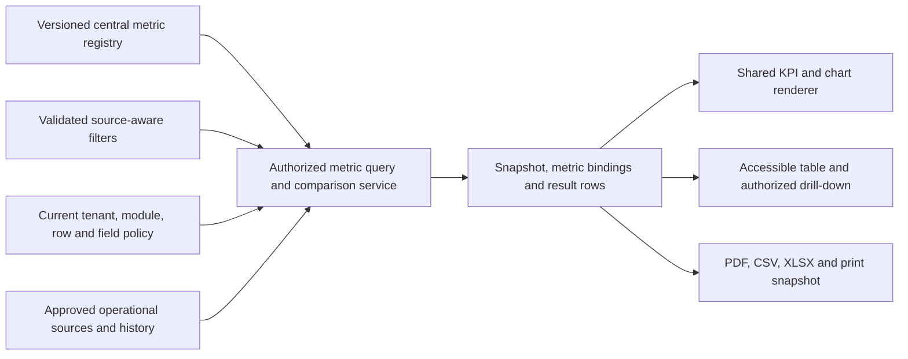

# Dashboard specifications and central analytics framework

Version 0.1 • 1 November 2026 • DASH-001–DASH-010 and MET-001–MET-005. Proposed UX contracts. No dashboard, query or new business metric is implemented by this phase.

## MET-001 — One metric definition, many views

[KPI_CATALOG.md](KPI_CATALOG.md) is the canonical definition of kpi.001–022: meaning, formula, grain/cohort, source, refresh, dimensions, permission, visualization and export. This document composes those metrics; it does not replace their formulas or calculate new totals in the frontend. Stored MetricDefinition versions/definition hashes identify compiled server-side metric recipes, not tenant-authored SQL. ReportMetricBinding and immutable ReportResultRow preserve the actual snapshot result.

Registry contract: metric key/version, label, meaning, exact server formula, approved source/joins, business grain, date/cohort basis, timezone/calendar, units/currency/rounding, denominator/exclusions, source permissions, allowed dimensions, freshness target, minimum-cohort/privacy rules, comparison eligibility, drill-down definition and export classification. Changing meaning needs a new definition version and reviewed impact on existing saved views/reports, never a local change to a card.

The same returned value/state supplies card, chart, table, comparison and export. UI code can format typed values using an exact-decimal-safe locale formatter, but cannot compute payroll, headcount, rates, deltas or source joins. No Number(amount) conversion that loses decimal precision. Chart/table sorting does not silently change a denominator. A metric unavailable under release/source/policy is never replaced with an invented calculation.

## MET-002 — Dashboard frame shared by all ten personas

1. Title and scope: current company, authorized entity/team/self context, clearly stated as-of and source freshness.
2. Filters: explicit date basis/range and applicable entity/department/team/client/owner/pay-period/currency. Apply/reset controls and visible resolved filter chips. An unavailable dimension is not sent as a fictitious API filter.
3. Summary: defined KPIs with units, denominator when needed, comparison only when valid, and a keyboard-accessible definition action.
4. Chart and table: an appropriate chart plus same-data table, with explicit scale/unit and source drill-down. Do not show a chart whose only distinction is color.
5. Actionable records: only records permitted by current scope; summary access never implies field/case access.
6. Save/export/print: saved view preserves filter definition, not authority. Export PDF/CSV/XLSX and print the authorized snapshot; controls require appropriate rights, with no extra paid upgrade for applicable retained-data recovery.

All ten dashboard contracts inherit C-16/20/21/22/23/34/42 and AX requirements. Read-only modules retain permitted source reporting/exports under the approved lifecycle; no new side-effect workflows are started. Source denial removes sensitive widget/record hints; admins may see a safe missing-configuration state. External clients are not shown any of these full-company dashboards.

## MET-003 — Metric/UI binding table

Formula and source fields are references to the central definition, not duplicated formulas here. The same ID/version must appear in the server result and the definition drawer.

| Central metric | Display contract / date basis | Presentation / refresh target | Comparison |
|---|---|---|---|
| kpi.001 / REQ-K001 Confirmed starts | Actual confirmed start period; distinct placements | Card + period bar; ≤5 minutes | Equal prior date interval with same entity/client/owner scope and calendar basis |
| kpi.002 / REQ-K002 On-time start rate | Original planned-date cohort; started denominator and separate unresolved/canceled | Percent card + cohort table; ≤5 minutes | Percentage-point change only for comparable/mature cohorts; show denominators |
| kpi.003 / REQ-K003 Overdue mandatory tasks | Backlog at as-of, not an event count over a period | Aging/category bar + task table; ≤5 minutes | Only with a valid historical snapshot/reconstructible source; otherwise no baseline |
| kpi.004 / REQ-K004 Start slippage | Median nonnegative calendar-day delay for defined original-date cohort | Median card + table; later distribution; ≤5 minutes | Comparable cohort medians, with pending/censored cases disclosed |
| kpi.005 / REQ-K005 Active headcount | Effective employment count at date; people count separately labelled | Card + historical trend; daily/change refresh | Prior effective point from history, not current status filtered backward |
| kpi.006 / REQ-K006 Employee turnover | Exits/mean daily headcount under definition | Trend/cohort table; daily | Percentage-point comparison with same exit/period scope; not 1−turnover labelled retention |
| kpi.007 / REQ-K007 HR lifecycle completion | Due-date closed-case cohort; open/canceled separate | Completion/status bar + case table; ≤15 minutes | Comparable completion cohort with explicit unresolved cases |
| kpi.008 / REQ-K008 HR request backlog | Open requests at as-of | Aging bar + request detail; ≤15 minutes | Only supported historical backlog baseline |
| kpi.009 / REQ-K009 Payroll input completeness | Eligible workers in one batch/requirements version | Progress bar + missing-input table; batch change/≤5 minutes | Comparable batch versions/worker populations; not an arbitrary 30-day average |
| kpi.010 / REQ-K010 Payroll unresolved exceptions | Required open exceptions in batch | Category/severity bar + rows; ≤5 minutes | Prior approved comparison point only if captured; no guessed historical trend |
| kpi.011 / REQ-K011 Approved net payroll | Finalized run; explicit entity/pay period/currency | Separate-currency card/bar + reconciliation table; finalization | Compatible finalized pay periods and currencies; **not employer payroll cost** |
| kpi.012 / REQ-K012 Shift coverage | Published schedule/version and capped staffed hours | Coverage bar + roster/list; ≤15 minutes | Same planning horizon/maturity and required coverage, if historical plan exists |
| kpi.013 / REQ-K013 Pending team approvals | Current actor/delegated team tasks at as-of | Queue count + age bar/table; ≤5 minutes | Historical comparable assigned scope only; otherwise omit delta |
| kpi.014 / REQ-K014 Leave balance | Own ledger as-of, separate unit/type/pending reservation | Balance cards + own ledger table; change/≤5 minutes | Opening/closing ledger context if meaningful; never a performance arrow |
| kpi.015 / REQ-K015 Employee request status | Own requests grouped by source-specific state | Status bar + own requests; ≤5 minutes | Optional comparable submission cohort, not all-time vs period totals |
| kpi.016 / REQ-K016 Sales pipeline value | Open stages at as-of, currencies separate | Stage bars + opportunities; ≤15 minutes | Prior captured snapshot with same scope/currency; pipeline is not revenue |
| kpi.017 / REQ-K017 Sales win rate | Won/lost terminal decisions in period | Percent card + decided cohort; daily | Percentage-point change for same period/filter definition |
| kpi.018 / REQ-K018 Renewal rate | Renewable contracts by due-date cohort, pending separate | Cohort bar/table; daily | Equally mature due cohorts and consistent renewable criteria |
| kpi.019 / REQ-K019 Customer health coverage | Current non-stale assessments among managed active accounts | Known/stale/unknown coverage + table; daily | Same health model/freshness/population, else state not comparable |
| kpi.020 / REQ-K020 First human response | Median business minutes under captured SLA calendar; unreplied separate | Median card + response distribution/table; ≤15 minutes | Same policy/calendar and comparable cohort, not average elapsed time |
| kpi.021 / REQ-K021 Resolution SLA attainment | Eligible resolved-ticket cohort under captured clock policy | Percent card + breach table; ≤15 minutes | Same policy/case eligibility or explicitly state policy changed |
| kpi.022 / REQ-K022 Customer satisfaction | Valid deduplicated rating scale, minimum cohort/privacy policy | Percent + response context/table; daily | Publishable comparable survey versions/cohorts only; suppression prevents individual drill-down |

Historical snapshots have limited retention; “previous month” is not automatically reconstructible from a seven-day export snapshot. Metric-specific histories/reviewed historical read models must support the requested comparison or the server returns comparisonUnavailable with a safe reason. Counts changing due to source correction show corrected-as-of and source version, not an unexplained frontend animation.

## DASH-001 — Executive / agency overview (SCR-06)

**R1 agency composition:** kpi.001–004, date/cohort selector with visible date basis, entity/client/owner filters and permitted source records. Department is not applicable without a supported placement-team mapping. Use four cards, confirmed-start period bars, overdue-task owner/aging bars and a prioritized placement/task table. Every KPI links to its registered source query; no HR/payroll/business widgets are teased to ordinary R1 users.

**Full-vision executive composition (Later):**

| Section | Registered content | Graph/table and business decision |
|---|---|---|
| Workforce | kpi.005 active employments and correctly labelled distinct people if supplied by that definition | Effective-dated headcount trend, entity/department breakdown and permitted employment drill-down |
| Payroll cost | Proposed MET-PROP-023 below, only after approval/complete supported sources; kpi.011 approved net payroll as a separately named measure | Currency-separated component/period bars and reconciliation. “Net payroll” is never presented as total cost |
| Recruitment | Agency kpi.001/002/004 when agency source exists; ATS pipeline/source records under licensed ATS, no invented ATS KPI | Start cohorts for agencies; authorized requisition/application-stage table for ATS. Corporate employees and placed candidates have distinct units |
| Retention and movement | kpi.006 employee turnover, kpi.005 history and permitted exit context | Turnover trend with exits/denominator; no fabricated cohort-retention percentage |
| Business pipeline | kpi.016/017, explicit source currency/stage and decision period | Stage bars/opportunity table; no pipeline-to-revenue equivalence or mixed-currency total |

Top filters: executive date/as-of plus source-aware entity/department/team; payroll panel has pay period/currency, recruitment has original/actual date basis, pipeline has close/decision/as-of basis. A single global interval cannot secretly override incompatible panel semantics. Widget subtitles expose resolved local dates. The viewer can save this composition only within authorized source capabilities. Export/print use the same source-aware snapshot and hide denied fields/sections, with scope metadata and generation time.

## DASH-002 — HR leadership (SCR-07 Leadership)

kpi.005/006/007, as-of or period/entity/effective department/team/employment-type filters. Headcount trend, turnover cohort table, lifecycle completion bar and source employment/lifecycle lists. Prior comparison obeys historical/cohort eligibility and source permissions; exit reasons remain separately restricted. PDF/CSV/XLSX/print use the same snapshot and privacy scope. A missing employee-history source is unknown, not stable workforce.

## DASH-003 — HR operations (SCR-07 Operations)

kpi.007/008 with due-date/as-of/entity/team/case-type/owner filters. Aging bar and case/request queue; drill into authorized cases, not attachments by default. No prior backlog arrow without history. Record-level work is prioritized over executive trend decoration. Export/print is permission-gated, same snapshot, and cannot disclose restricted employee cases through a summary row.

## DASH-004 — Recruiter (SCR-27)

kpi.001–004 under own/allowed team/client/entity/owner scope. Source-aware dates, start-cohort bars and overdue-task list/table; primary action opens a permitted task/placement. Show that “My work” is not the company total. Comparison uses identical cohort/scope and otherwise has an explicit no-baseline state. R1 supports save view, three export formats and print under reporting rights; no separate formula is created for the recruiter version.

## DASH-005 — Payroll teams (SCR-11)

kpi.009/010 and later kpi.011 with entity/pay period/provider/batch/currency filters; authorized department/worker-category slice only where supported. Completeness progress plus exception bars/source reconciliation table. Approval roles and amount permissions are independent. Prior pay-cycle comparison requires equivalent period/type/currency/worker definitions. Export/print may be restricted independently from preparing/approving and must include rule/provider/source versions. Employer cost remains a distinct proposed metric.

## DASH-006 — Line managers (SCR-21)

kpi.013 and kpi.012 only if scheduling is enabled. Assigned entity/team/calendar/horizon and source-type filters, pending approval age bar/table and coverage bar/roster. Drill-down is a decision detail with permitted evidence, not an instant approval on a chart. No historical comparison for delegated/changed scope unless a comparable prior scope exists. Scoped PDF/CSV/XLSX/print excludes medical/payroll details. Manager role alone does not authorize them.

## DASH-007 — Employees (SCR-20)

kpi.014/015 only, current company/self context, leave type/policy year/units and own request date/type filters. Department switching is irrelevant and unavailable for self-only access. Use balance/posted-vs-pending explanation, request-status bar and own ledger/request table. Comparison is optional opening/closing context, not “you took more leave than colleagues.” Export/print of one's permitted dashboard is supported when scoped export rights apply; statutory access/exit data requests remain separately available without a paid analytics upgrade. No coworker drill-down or global aggregate.

## DASH-008 — Sales (SCR-14 Summary)

kpi.016/017, entity/assigned sales team/owner/account/date basis/currency. Stage bars and decided-opportunity cohort/table, with one currency per measure. No weighted forecast/revenue estimate without another centrally approved metric. Prior pipeline needs a snapshot; win-rate comparison needs a comparable decided cohort. Export/print includes source stage/probability definition where applicable but no restricted employee/candidate data.

## DASH-009 — Customer success (SCR-28)

kpi.018/019, entity/account owner/team/customer segment/due-date cohort/health-model filters only when supported. Renewal cohort table and current known/stale/unknown health coverage bar. Drill to permitted account/contract/factor records; restricted case content remains absent. Compare equally mature renewal cohorts and identical health model versions. Export/print reflects the source permissions; no average-health or renewal-prediction calculation is invented.

## DASH-010 — Support (SCR-29)

kpi.020–022, entity/assigned queue/team/priority/SLA-policy/calendar/date-cohort filters. Median response distribution, SLA breach table and publishable satisfaction context with counts/rates per definition. Suppress small survey cohorts and identity-revealing drill-down/differencing; do not export suppressed raw responses. Comparisons require equal policy/calendar/eligibility, otherwise indicate policy changed. PDF/CSV/XLSX/print includes captured SLA/metric context and only permitted case rows. Vendor support access is not granted here.

## MET-004 — Comparisons, privacy and state contract

Server response distinguishes value, noData, unknown, notApplicable, suppressed and sourceStale; authorization denial never includes a sensitive result. comparison has current/prior result references, resolved intervals/scopes, absolute difference and/or percentage-point difference with a declared unit, or an explicit unavailable reason. No dividing by zero into infinity, percentage change of a percentage, or implicit different-currency subtraction. The frontend displays supplied results and ordinary locale formatting only.

Filter choices are scope-filtered before their values/counts are fetched. Effective department/team assignments use the requested business/as-known date; do not infer an employee's past department from today's profile. Phase 3 FilterAst must gain reviewed team/department dimensions before those controls are implemented. Anonymous/small-cohort analytics need both primary and complementary/differencing protections, export parity and permitted dimensional combinations; hiding one chart label is insufficient.

Source freshness is not page-refresh time. On async run show queued/working/ready/failed/expired explicitly; never interpret zero result rows as completion. UX-DELTA-05 includes a reviewed operation/status projection because the existing immutable ReportSnapshot metadata alone is insufficient to communicate all asynchronous run states. Any necessary API/model change must be approved before implementation. Recheck permission/source availability at generation and download, and reject stale-scope artifacts with safe regeneration guidance.

## MET-005 — Proposed employer-payroll-cost definition (UX-DELTA-01)

**ID:** MET-PROP-023, proposed future key kpi.023; not approved, not in the existing KPI_CATALOG, and unavailable in R1. **Meaning:** recognized employer payroll expense for a defined entity/pay period under an approved accounting/taxonomy policy, not net wages transferred.

**Proposed formula:** sum of approved finalized employer-cost component facts for the selected entity/pay period/run version, grouped by currency and cost classification. Included components may be gross earnings, employer payroll charges and approved employer-benefit accruals only under a reviewed taxonomy/allocation policy. Exclude employee deductions, duplicate gross/component postings, unrelated reimbursements and pass-through amounts unless the approved policy explicitly classifies them as employer payroll expense. Adjustments retain their linked original/adjustment periods and version.

**Missing source contract:** the current schema has calculation lines and benefit enrollment, not a complete classified employer-cost/accrual fact set. A proposed normalized cost-component source needs immutable source ID, entity, pay period, run/adjustment version, cost category, exact amount/currency, approval, effective date and taxonomy/allocation version with reconciliation. Do not assume enrollment price, expense amount or net pay supplies the missing fact. Data-model/API/source reconciliation changes require approval.

**Proposed refresh:** after finalization/approved cost adjustment; display as-of and component coverage. **Dimensions:** entity, supported effective department/cost allocation, pay period, currency and reviewed cost category. **Permissions:** reports.read plus explicit payroll.cost.read and all applicable restricted financial source scopes; executive title alone grants none. **Visualization:** currency-separated cost-component bars and reconciliation table. **Exports:** PDF/CSV/XLSX/print under the same scope/snapshot. **Validation:** finance/legal approval of recognition/allocation, no double counting, gross-vs-net reconciliation, exact decimal/rounding, historical adjustment, currency and source-completeness tests.

Until complete/approved, the executive cost section states unavailable/partial coverage to a permitted administrator and makes no total-cost claim. Show approved net payroll separately only when its own source permission permits. Review this proposal with product/data/finance owners before adding it to the central registry or building a cost widget.
