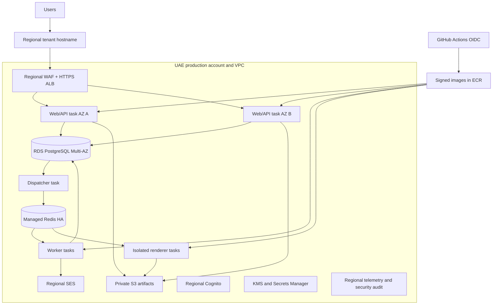

# Deployment architecture

Baseline: 1 November 2026. DEP-001–DEP-006 describe proposed infrastructure and release operations. Nothing was provisioned or deployed. Cloud-region/account/service availability, budgets, quotas and actual application compatibility require validation before applying infrastructure.

## DEP-001 — Initial production topology

Select AWS me-central-1 (UAE) as the initial tenant home cell. Use dedicated production account, separate staging account, workload roles, regional KMS/Secrets Manager and private data services. R1 is one regional cell, not global active-active. At least two application instances across available AZs avoid a single web-container failure; database/Redis HA topology and exact classes are verified against region capabilities before ordering.

No global CDN caches private pages/API responses. Public immutable assets may use a CDN only after a residency/telemetry review; do not assume a global frontend edge has no personal metadata. ALB terminates approved TLS; internal service connections remain encrypted and security-group restricted. Database/Redis have no public endpoints. Use regional private endpoints to supported AWS services, and controlled NAT/egress for approved external providers. Renderer has no general outbound Internet route. Pin local fonts instead of loading them from third-party CDNs during a report.

AWS Cognito/SES endpoint tables were retrieved and list UAE endpoints. Confirm ECS/Fargate/RDS engine/ElastiCache engine/KMS/logging availability, account quotas, SES verified domain/sandbox exit, provider subprocessors and operational access before committing a residency or delivery contract. A documented endpoint is not a tested production account configuration.

## DEP-002 — Build and CI/CD

Use Docker multi-stage images, immutable digests, non-root/read-only root filesystem where supported, dropped Linux capabilities, seccomp/sandbox settings, resource limits and minimal runtime dependencies. Renderer is a distinct image containing reviewed PDFKit and local fonts; structured layout avoids a browser/sandbox dependency on Fargate. Apply resource/network confinement and validate PDF structure, table pagination, glyphs and accessibility. A later switch to HTML/browser rendering requires a new isolation/runtime review, not a disabled sandbox. No development tools, package-manager credentials or production secrets in images.

Proposed pipeline:

1. Pull request: frozen install; formatting/type checks; import-boundary rules; unit/property tests; real PostgreSQL runtime-role/RLS and Redis integration tests; OpenAPI/event compatibility; accessibility and synthetic end-to-end/export checks.
2. Security gates: dependency/license/secret/SAST/container/IaC scans, SBOM and provenance; fail release for critical authorization/security findings and reviewed severity policy. Verify test assertions actually ran.
3. Build once and sign/tag digest. Promote the same digest to staging and production; no different rebuild at deploy time.
4. Terraform plan with reviewed diff, narrow OIDC role, protected production environment and state locking. Terraform state is encrypted/access-controlled and contains secret references, not copied secret plaintext where avoidable.
5. Regional one-off migration task obtains a separate migration identity from Secrets Manager. Hosted CI never connects to a public production DB or downloads a customer dump. Review SQL role/RLS changes separately.
6. Deploy compatible worker/web versions, run regional synthetic smoke/tenant-isolation/entitlement/export checks, then gradually shift traffic with rollback criteria and health alarms.

GitHub OIDC trust restricts repository, branch/environment, audience and exact deploy actions; no standing AWS access key. Production approval occurs in the implementation delivery process, not this document. Keep migration and runtime policies separate; ordinary deploy credentials cannot assume a broad database-owner session without the dedicated migration path.

Schema changes use expand → compatible readers/writers → backfill → switch → contract in a later release. Backfills are bounded tenant-scoped jobs with audit, progress, rollback strategy and retention review. Never combine destructive migration and application rollback assumptions. Database migration rollback usually means forward repair; a database restore loses later legitimate writes and is an incident decision, not the normal button for a failed deployment.

## DEP-003 — Capacity, concurrency and monitoring

Begin with a measured staging sizing exercise, not an invented cost or instance-count promise. Initial topology needs two web tasks, a dispatcher, a bounded worker pool and a separate renderer pool; merge dispatcher scheduling into a worker only with a singleton lease and durable recovery. Tune CPU/memory/database class against the PRD envelope: 20 concurrent users/tenant, 10,000 placements/tenant, 100-row pages, 1,000-row imports and 5,000-row exports. Global tenant count/load is unknown and must be supplied or measured before a capacity commitment.

Use bounded PostgreSQL pools with total maximum across web/workers/migrations below the database connection budget; scaling task count without adjusting pools can exhaust DB before CPU scales. Long renderer work does not hold a source database transaction: create an authorized immutable snapshot, close transaction, render in isolation, reauthorize publish/download. Apply statement timeouts, work-memory limits and indexed source predicates. Dispatch fences are a deliberate short bounded exception, monitored for lock wait and never used for full report generation.

Autoscale web by sustained latency/request/CPU and workers by queue age/throughput with per-tenant fairness; cap renderer concurrency/memory and export reservations. Redis uses protected connectivity, backups/replication as available and a no-eviction policy appropriate for BullMQ; cache eviction must not silently discard jobs. Redis is still not the source of business durability. Reconstruct queued work from PostgreSQL and deduplicate effects after loss.

OpenTelemetry spans carry correlation and opaque tenant/cell IDs, no candidate names/payroll values/document bodies. Monitor p50/p95/p99 latency, errors, availability, DB saturation/locks/connections, queue age/retries/dead letters, failed reminders, SES bounces/complaints, export denials/failures, quota conflicts, auth anomalies, policy revisions, backup age and restore-test age. Alert on tenant-scope denial spikes and evidence of context leakage. Aggregate tenant labels carefully to avoid unbounded metric cardinality or sensitive business metadata exposure.

Targets from REQ-P008: 99.5% monthly core API availability, p95 reads <2s and writes <3s at the tested envelope, RPO ≤24h and RTO ≤8h for supported recovery scenarios. Define availability/error-budget measurement and exclusions before contract use. No benchmark/SLA attainment is claimed in this phase.

## DEP-004 — Backup, deletion and disaster recovery

Use encrypted RDS automated backups/PITR and tested regional restore; proposed maximum automated backup age is 35 days to align with the PRD deletion-bound. Indefinite manual snapshots, copied snapshots and S3 object versions would violate that bound unless separately approved, so inventory/expire them too. Account for transaction logs, staged files, reports, credentials and support copies, not just the main table. Key deletion is reviewed against required retention and recovery, not used as an improvised erasure shortcut.

Restore procedure: isolate restored infrastructure → disable outbound jobs → validate backup integrity/schema → replay current deletion/hold ledger and invalidate stale sessions/credentials → reconcile queue/outbox/provider effects → verify tenant/scoped permissions and data counts → obtain recovery approval → resume traffic and only safe pending work. Do not send all historical overdue reminders after restoration. Maintain an out-of-band encrypted minimal deletion ledger so restoring yesterday's DB does not lose today's erasures.

Quarterly proposed full restore exercise and more frequent backup/PITR checks produce measured recovery time and maximum data loss. Test corruption, AZ failure, Redis loss, compromised credential and accidental deletion. Full regional outage is explicitly not covered by same-region Multi-AZ; an approved alternate region/transfer mechanism or an accepted RTO exception is required before claiming regional disaster recovery. Active-active cross-border replication is not an R1 feature.

## DEP-005 — Environments, support and operations

Development uses synthetic data and later documented local containers; no production credentials or personal data. Staging uses separate identity pool, DB, buckets, keys, mail destinations and tenant IDs. External emails are sandboxed/allowlisted. Do not clone a production database into a less protected environment. Support requires the SEC-003 approved expiring grant, not direct SQL from a laptop.

Runbooks: auth/IdP outage; DB failover/restore; tenant-scope incident; Redis rebuild; dead-letter/reconciliation; module deactivation fence contention; export/renderer failure; SES bounce/rate issue; deployment rollback/forward repair; subject-erasure/hold; residency migration; key rotation; jurisdiction-rule withdrawal. Each has owner, detection, safe containment, recovery verification and escalation. A managed service reduces maintenance but does not remove these responsibilities.

Cost model before provision: compute by workload, HA RDS/Redis, storage/version/backup bytes, ALB/WAF/NAT/endpoints, KMS/log retention, mail volume, CI, support and recovery exercises. Use current provider calculator/quotes after sizing; no unsupported UAE monthly price is asserted. A smaller single-VM design costs less but weakens failure isolation/operations and is not the selected production baseline.

## DEP-006 — Release and evidence checklist

Before relevant production activation: supported patched version matrix; infrastructure plan review; real RLS/tenant/scoped policy tests; capacity/queue race tests; renderer confinement/resource test; all three reconciled export formats; invalidated download check; backup restore/tombstones; verified data-processing/residency/retention terms; source/provider coverage and current legal-review gates; on-call/tabletop; signed build and rollback plan. R1 later-feature activation tests must fail even if an admin supplies a plan grant.

Attach results to TEST-P008/P009, TEST-E006/E008/E014, TEST-R005/R006 and TEST-L001–TEST-L006. An architecture document or diagram is not evidence that any of these checks passed. This task creates documentation only and does not change the environment draft, publish, deploy, send email or provision cloud accounts.
