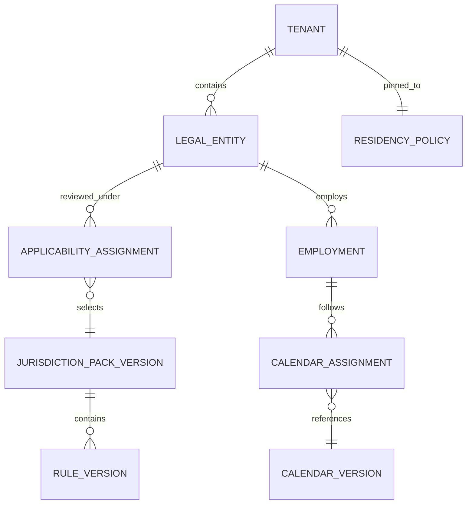
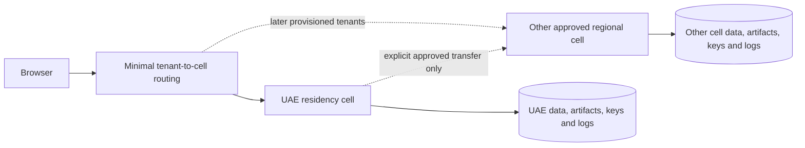

# Globalization strategy

Baseline: 1 November 2026. GLOB-001–GLOB-005 refine REQ-P007/P011/P012, REQ-F042/F043 and all entity/country-sensitive features. Shared model with versioned jurisdiction adapters; English R1 and no production payroll rules.

## GLOB-001 — Global data and presentation model

| Concern | Shared representation and behavior | Validation / trade-off |
|---|---|---|
| Country/jurisdiction | ISO country code plus separate jurisdiction/regime and employing authority references | Country is not an employment-law decision. No `is_uae` switch controlling all entities |
| Legal entities | Tenant owns LegalEntity records with registration/authority, operating locations and effective-dated employment, privacy and tax applicability | One tenant may have several regimes. A client account is not automatically the worker's employer |
| People/identifiers | UUID person/reference plus typed identifiers with issuing country/authority, validity, encrypted value, purpose and masking policy | Names are Unicode, no required Western first/last-name assumption. Local ID format validation is adapter-specific; no universal numeric ID or email uniqueness |
| Money | Decimal amount + ISO currency, calculation scale/rounding rule and version; never JavaScript binary floating point for payroll/fees | No mixed-currency total. Store supplied/exchange source, rate, date and purpose for approved conversions; report conversion is not settlement |
| Instants | UTC timestamptz, source IANA timezone and user display preference | User timezone does not change contractual/business dates |
| Business dates | SQL date for planned start, birth/leave/contract dates with explicit calendar interpretation | A date is not midnight UTC. Avoid browser parsing that shifts a date across day boundaries |
| Local schedules | Local date/time + IANA zone + recurrence policy, resolved occurrence instant, timezone-database version | Specify DST gap/fold handling and dedup key; keep prior run's resolution when the tz database changes |
| Languages | BCP 47 locale, translation keys, ICU plural/select messages, preferred language independent of nationality | English R1; Arabic/RTL requires actual translations, native review, keyboard/screen-reader QA and local font embedding |
| Dates/numbers | Intl/ICU formatting, explicit parse formats and locale/currency labels in files | Accept ISO machine imports; local display and ambiguous date entry must show examples/confirmation. Never infer currency or legal rules from locale |
| Workweeks/holidays | Versioned work calendar per entity/site/employee assignment; days off, partial days, observed holidays and working-time units | Do not hard-code UAE weekends or future lunar holidays; official announcement/provenance and customer approval update the version |
| Durations | Minutes/hours/calendar days/working days as distinct typed units | Federal annual leave and ADGM working-day leave cannot share an unlabeled integer balance |
| Addresses/contacts | Country-aware optional fields, international phone format, preserved original input | No universal postal-code requirement; contact normalization never automatically merges identities |
| Documents | Purpose/type/authority/version/language/expiry metadata and access policy; files later | Template translation is not legal equivalence; human/legal review required |

Search uses normalized lookup values in addition to original text, with reviewed transliteration rules. Do not normalize away meaningful Arabic/name distinctions or use fuzzy matches as identity proof. R1 PostgreSQL trigram/full-text search is scoped before ranking; Arabic recall/ranking requires real test fixtures before broad support claims.

## GLOB-002 — Applicability and configuration

ApplicabilityAssignment records domain (employment/payroll/privacy/identifier), authority, worker/employment category, entity, effective interval, source, reviewer and approval. Employment law and data-protection regime can differ; a free-zone address alone does not resolve all categories. Require a human-approved onboarding applicability assessment for regulated outputs.

All versions are immutable with `valid_from`, `valid_to` (exclusive), `recorded_at`, publication/source date, approval actor and supersession reference. Prevent overlapping active versions for the same scoped rule unless explicit precedence is defined. Preserve both business-effective time and when the system learned the change. A correction posted today must not falsify what was known when a prior payroll was approved.

Tenant policies may improve benefits where legally allowed but cannot bypass a statutory floor by editing settings. Resolve: applicable binding legal version → approved entity/contract provisions → employee-specific approved terms. This is a precedence framework, not a universal legal interpretation; each adapter defines reviewed precedence and conflict handling. Ambiguous or missing applicability yields a blocking review case for the affected calculation, not a guessed rule.

## GLOB-003 — Jurisdiction adapters and legal change control

Adapter interface: `resolveCoverage(context, effectiveDate)`, `validateInputs`, `evaluateDraft`, `explainCalculation`, `requiredEvidence`, `retentionPolicyReferences`, `providerFormatCoverage`. Inputs are explicit entity/regime, employment type, dates, contract/benefit terms, rule version and typed quantities. Outputs are pure structured results, reasons, rounding, citations and warnings; no database, network, payment, permit submission or arbitrary tenant code inside a rule evaluator.

Pack manifest includes stable ID/version, official sources and captured hashes, effective dates, explicit included/excluded cases, legal reviewer, engineering reviewer, calculation fixtures, migration effect and expiry/review date. Proposed UAE pack IDs remain separate `compliance.pack.ae.mainland`, `.difc` and `.adgm`; some entities need narrower adapters after legal review. No generic “UAE compliant” flag.

Change workflow: detect official publication → capture and authenticate text → assess affected entities/periods → legal interpretation → implement reviewed adapter/version and fixtures → dual approval → customer impact preview → effective-date activation. Backdated changes create a reviewed correction/adjustment run rather than silently rewriting finalized history. Keep prior rule versions available for lawful explanation and audit. Unknown regulation, obsolete pack or uncovered worker case blocks affected payroll finalization. It does not block a neutral R1 task checklist.

Tests: first/last effective day, amendment overlap/gap, partial service, leap year, unpaid periods, national/non-national distinctions where applicable, working/calendar day units, currency precision, new versus historical scheme participation, termination exception, and no unsupported cross-regime fallback. Legal-reviewed expected outputs are mandatory; production formulas cannot be copied from market-research summaries.

## GLOB-004 — Residency cells and controlled transfers

R1 tenant has one home residency cell. Initially plan an AWS UAE cell in me-central-1 with regional compute, database, Redis, S3, Cognito, KMS, Secrets Manager and telemetry. This is a product hosting choice, **not a conclusion that UAE law universally mandates UAE-only hosting**. Confirm all processor support, control-plane metadata, identity, email and operational access flows separately.

The routing directory contains only opaque tenant ID, cell and health/config version, no HR records or emails; its metadata still receives a privacy review. Prefer region-specific tenant URLs and regional sessions. IdP identities/tokens are region-local; a person with workspaces in two cells has separately verified regional memberships, not an automatic globally replicated profile. No cross-cell SQL joins, object copies, analytics or admin searches.

One R1 tenant cannot select mutually incompatible per-entity residency countries. If an entity requires a different location, provision a separate tenant/cell and controlled intercompany integration, or defer the contract until a separately reviewed partitioned-tenant design exists. Never silently route one entity's data abroad just to preserve a single dashboard.

ResidencyPolicy covers primary storage, backups, file versions, search indexes, report/render temp space, authentication, telemetry, email providers/recipients, support access, CI debugging and subprocessors. Cross-border downloads/remote access can be transfers even with a local database. Record purpose, lawful mechanism, recipients, minimization, safeguards and legal approval. Do not infer a lawful transfer from a KMS key or a cloud region label.

Tenant relocation is a separately authorized migration: evaluate transfer/retention, pause writes/jobs, snapshot and checksum, transfer through approved encrypted channel, verify row/permission/metering/tombstone state, rotate credentials, switch routing version, revalidate sessions and resume. Retain/delete old copies under approved terms, with rollback limits and no double-dispatch. No self-service residency dropdown moves data instantly.

## GLOB-005 — Privacy, calendars and reporting validation

Data retention is record-purpose/entity/regime-specific, not language/country alone. The PRD's 12-month/24-month/seven-day/35-day values remain proposed product defaults and must be overridden where law/contract requires a different approved schedule. Federal Article 13 employee-file retention evidence does not automatically apply to every candidate record or every free zone. Preserve lawfully required employment records while erasing unnecessary duplicates; holds must be scoped.

Global reporting always states date semantics, local zone, currency and rule/metric version. Do not sum AED/USD net payroll, treat a working-day leave entitlement as calendar days, or show a relative date filter without resolved dates. Scheduled reports later specify DST gap skip and fold single-run policy explicitly; no wall-clock scheduler with implicit UTC assumptions.

Acceptance links: TEST-P007 for locale/accessibility, TEST-P011/P012 for provenance/versioned configuration, TEST-F042/F043 for applicability, TEST-R002/R008 for snapshot/schedule consistency, TEST-P005/E007 for retention/restore. Add fixtures for Dubai, a DST-observing location, Arabic RTL, mixed currencies, changing holiday calendars, multiple employment regimes in one tenant and wrong-cell requests before claiming global readiness.
