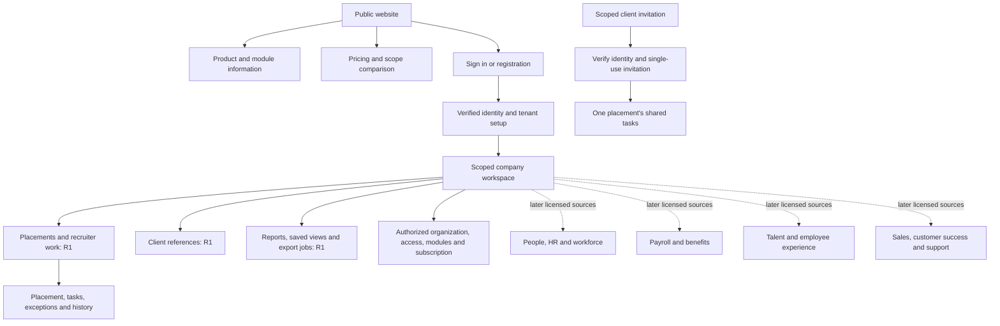

# Information architecture, navigation and sitemap

Version 0.1 • 1 November 2026 • IA-001–IA-005. Route names here are proposed user-interface routes, not new API handlers. Security and module enforcement remain server-side.

## IA-001 — Product spaces

Three separate contexts: public website; authenticated company workspace; narrowly scoped external participant view. Future employee self-service is a distinct navigation mode within an authorized tenant, not a public portal to all staff. The SaaS operator console is outside tenant navigation and requires the separate support-access contract.

Public navigation: Product, Modules, Pricing, Security, Resources, Sign in, Request a conversation. R1 public messaging leads with placement coordination. A “Planned” product has an informational page and no trial/purchase promise. No unsupported country compliance badge, fabricated testimonial or metric outcome appears.

Workspace header: company switcher, active entity/context summary, page/search control where supported, accessible help and user menu. Global search is only an authorized source search; no hidden module names/counts leak through suggestions. Clear all record-selection/filter/cache state on tenant switch and re-check identity/cell; warn about safe unsaved work first. Entity filtering stays inside a tenant and never changes tenant membership.

## IA-002 — Main navigation

| Group | Full-vision items | R1 visible slice | Eligibility |
|---|---|---|---|
| Overview | Executive, HR leadership/operations, recruiter, sales/CS/support dashboards | Agency overview and recruiter work | Per dashboard source permissions; no full-suite placeholders for ordinary users |
| Recruitment | Accepted placements, task views, candidates, requisitions/pipeline, interviews/offers | Placements, assigned tasks, minimal candidate references, import | agency.starts and scoped capabilities; ATS marked Later in admin catalogue only |
| People | Directory, employment records, lifecycle, documents/assets | None | hr.records and relevant optional modules |
| Workforce | Leave, attendance, scheduling and assignments | None | hr.leave/workforce.time/schedule; manager/team scopes |
| Pay and benefits | Input workspace, pay runs, statements, compensation, benefits/expenses | None | Relevant payroll/benefit/compensation modules and restricted fields |
| Talent | Performance/goals, learning, skills/succession | None | Applicable talent modules |
| Customers | Accounts/contacts, CRM pipeline, success, support | Client references/contacts only | crm.accounts minimal R1; each later area separately licensed |
| Reports | Reports center, saved views, export jobs, later schedules | Registered agency reports/saved views/exports | Source permissions plus reports.read/export; no implicit data entitlement |
| Administration | Organization/access, templates, modules, subscription, integrations, audit/privacy | Supported settings, versioned placement templates, module/contract controls, CSV, authorized audit/privacy | Admin action/scope; does not imply salary access |
| My workspace | Employee and manager portal modes | None; recruiter work is agency work, not employee portal | Later self/team rights |

Users with many domains see collapsible named groups, not a second row of tabs for every product. Remember expansion preference per membership, never a permission decision. Users with one module see a short navigation rather than an empty enterprise mega-menu. Breadcrumbs show domain→record and do not expose forbidden parent names.

## IA-003 — Sitemap

| UI route family | Screen IDs | Context |
|---|---|---|
| `/`, `/product`, `/security` | SCR-01 | Public; static verified content only |
| `/pricing`, `/modules` | SCR-02 | Public catalogue; no customer data |
| `/register`, `/sign-in`, `/auth/continue` | SCR-03, SCR-26 | Verified identity/region-bound bootstrap |
| `/setup` | SCR-04 | Authorized setup wizard, resume only under verified context |
| `/app/overview` | SCR-06 | R1 agency or later entitled executive composition |
| `/app/recruiter` | SCR-27 | R1 own/team agency work |
| `/app/placements`, `/app/placements/:id` | SCR-22, SCR-23 | Scoped agency records |
| `/app/imports`, `/app/imports/:id` | SCR-24 | Permitted import/error workflow |
| `/app/customers/:id` | SCR-15 | R1 client reference or licensed later account tabs |
| `/app/reports`, `/app/reports/exports/:id` | SCR-16 | Registered report/snapshot/job scope |
| `/app/settings/organization`, `/access`, `/privacy`, `/audit` | SCR-05 | Scoped administration |
| `/app/settings/templates` | SCR-17 bounded | R1 versioned placement template configuration, not drag automation |
| `/app/settings/modules`, `/subscription` | SCR-18, SCR-19 | Commercial admin, not general user upsell |
| `/shared/placements/:id` | SCR-25 | External scoped view, no full workspace shell |
| `/app/hr`, `/people`, `/people/:id` | SCR-07–SCR-09 | Later HR sources |
| `/app/recruitment`, `/payroll`, `/workforce`, `/performance` | SCR-10–SCR-13 | Later domain workspaces |
| `/app/sales`, `/success`, `/support` | SCR-14, SCR-28, SCR-29 | Later customer operations |
| `/self`, `/manager` | SCR-20, SCR-21 | Later self/team portals |

Human UI routes never substitute for `/api/v1` contract enforcement. Invalid direct links show a safe not-found/unauthorized result without a sensitive breadcrumb. Preserve user intent through authentication, but verify it after login; never trust a return URL to an arbitrary external host.

## IA-004 — Availability and navigation state matrix

| State | Navigation and direct-link result | Data behavior |
|---|---|---|
| Active and permitted | Relevant navigation, counts and actions | Current authorized source data |
| Active but no capability | Omit navigation/record hints; safe direct-link denial | No hidden counts or field names |
| Supported but not purchased | Only admin catalogue shows optional module and request options | No accidental data preview; no granted role from purchase |
| Not yet supported | Admin information marked Planned, CTA “Discuss future needs” if offered | Cannot buy/activate through a hidden link |
| Previously active/read_only | Archive-labelled navigation for authorized readers; export remains discoverable | Retained data, normal schedule, blocked business writes |
| Commercial suspension/trial expiry | Applicable read/export window and contract banner | No automatic deletion/charge, no new side effects |
| Security suspension | Explicit safe recovery/support route for authorized owner | No ordinary retained-data view until verified recovery |
| Scope revoked | Remove old nav/search/view state; tell user access changed without data detail | Existing files/links reauthorized; previously downloaded copies cannot be recalled |

The same component labels a module's operational state separately from commercial plan/usage. A toggle cannot simultaneously purchase, migrate, activate dependents and change privacy rules without a reviewed preview. Activation preview lists exact dependencies/charges if approved, or says a quote/approval is needed.

## IA-005 — Naming, findability and validation

Use “Placements” for agency accepted offers and “Employees” for the company's workforce; never put candidates in the employee directory. “Client accounts” are the tenant's customer records, not other subscribing tenant workspaces. “Reports” contains analysis and export jobs; “Audit” contains controlled operational evidence, not a public activity stream. Avoid generic “Manage” labels without an object.

Validate findability through the journey tasks: locate an overdue accepted placement, identify the owner, retrieve original plan, invite a client, export a retained record after module-off and distinguish an unavailable product from denied permission. Test navigation at 320 px, keyboard-only, 200% text and RTL mock content before sign-off. No tree test or usability success rate has been measured yet.
