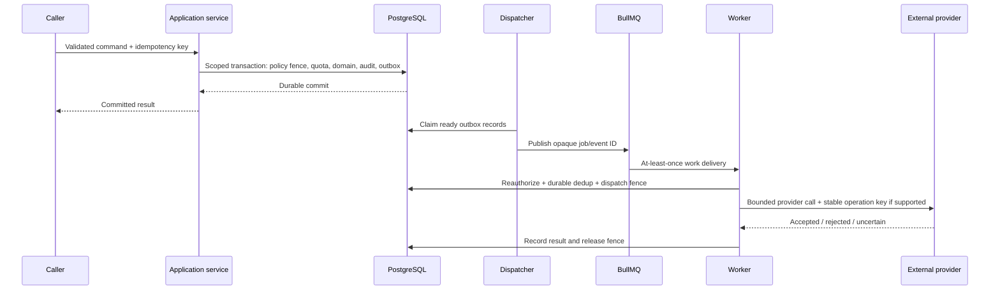

# Integration architecture

Baseline: 1 November 2026. INT-001–INT-006 refine REQ-P006/P011, REQ-F013/F014/F038/F040/F041 and REQ-E001–REQ-E014. R1 supports documented CSV import, fixed email reminders and report export only. Public API/ATS/payroll/bank/messaging connectors are later packages, not working integrations.

## INT-001 — Ports, contracts and credentials

Owning domains expose typed command/query ports, not public tables. The integration module validates external schemas, maps to domain DTOs and calls the same policy/transaction services as UI requests. A connector cannot bypass quota, module state, tenant isolation, field policy, idempotency, jurisdiction review or record version checks.

Public REST later uses OpenAPI versioned schemas, explicit pagination/cursors, field allowlists and safe error codes. Service principals belong to one tenant/cell, named package/provider, scopes and expiry. Prefer scoped OAuth authorization where supported; store encrypted token references in the tenant's region and rotate/revoke on disconnect. No token in URLs, browser storage, logs, queues or callback responses. Subscription to addon.api is not an action permission, provider certification or license to access every module.

For each supported provider record package ID, provider/API version, country/entity coverage, data fields/purposes, authentication, source of truth, synchronization direction, conflicts, rate limits, costs, processor/transfer assessment, test fixtures, operational owner and deprecation policy. Proposed packages connector.ats, connector.accounting, connector.payroll_provider and connector.messaging have no certified providers in this phase.

## INT-002 — Delivery semantics

Durable Outbox and Job are business intent; Redis is dispatch infrastructure. Unique `(tenant_id, operation_type, idempotency_key)` prevents duplicate command creation. Consumer Inbox deduplicates `(tenant_id, consumer, event_id)`; payload hash mismatch under the same key is a conflict, never a silent replay. Retain dedup records for at least the agreed maximum replay/provider retention window; approve that window before enabling a connector.

Do not mark an effect complete merely because its job was dequeued. Handler state: pending → reserved/running → succeeded, rejected, retryable_failed, outcome_unknown or dead_letter. Store attempts, next retry, provider reference, request hash and safe reason. Use exponential backoff/jitter and provider Retry-After, bounded attempts/deadline, per-tenant fair concurrency and a reviewed dead-letter replay interface. Replayed jobs must recheck present permissions and module state, not historical grants.

External exactly-once execution is not guaranteed. Where the provider supports idempotency, retain the same stable key on retry. Where it does not, query provider state/reconcile using a stable reference before retrying uncertain calls. SES send acknowledgment and email delivery are different; delivery can duplicate or bounce. Avoid marketing or workflow claims of perfect exactly-once notification. Domain updates remain idempotent even if a human sees a duplicate email.

## INT-003 — Imports, synchronization and ordering

R1 CSV lifecycle: authorized staging → byte/row/schema/field validation → dry-run mapping/errors → review → atomic domain commit → audit/provenance → source-file expiry. Enforce maximum 10 MiB, 1,000 rows/batch and approved minimal account/contact/candidate-reference/placement schema. Reject formulas, forbidden sensitive fields and unsupported encodings; show row/column codes without dumping source rows into logs. Preserve original dates, external source IDs and source profile. Reserve the whole batch's commercial capacity before commit; errors do not silently commit partial rows. Stage/error files expire after 30 days or earlier under the approved subject/purpose policy; generated operational exports expire after seven days.

Commit uses row-source keys scoped by tenant/profile, payload hash, current entity/client permissions and domain optimistic versions. An identical re-import returns prior outcome; changed content under the same idempotency key conflicts. An authorized correction is an explicit new batch/version. Never merge people automatically by email or overwrite human readiness/approval from a new feed. Missing fields have defined preserve/clear semantics—blank CSV cannot accidentally wipe a required client association.

Later connector delta sync records cursor/watermark, provider timestamp/version and internal version. Ordering is per aggregate/source, not guaranteed globally. Stale provider events cannot replace a newer approved state; store/review conflict. Reconciliation compares source counts/IDs/statuses at a stated as-of, not just “last job succeeded.” Disconnect pauses sync and revokes credentials while retained domain data follows its normal schedule. Reactivation previews stale mappings and does not auto-replay missed side effects.

## INT-004 — Webhook and outbound security

Validate provider signature over exact raw body, timestamp, endpoint binding and active credential before parsing. Enforce bounded body, event type/schema, replay window and durable event dedup. Acknowledge only after durable accepted inbox state; retry processing separately. Do not trust a payload tenant ID: resolve destination from the configured endpoint/credential and verify the resource mapping. Handle signing-key rotation and record version without exposing secret material.

Outbound webhook URLs need explicit admin/provider approval, HTTPS, verified DNS/public IP at connection time, bounded redirects and a revalidation at each redirect. Deny localhost, private/link-local ranges, IPv6 local ranges, cloud metadata and internal service addresses. Prevent DNS rebinding/TOCTOU through a controlled egress resolver/proxy; URL regex checks alone are insufficient. Never forward Authorization/cookies to a redirected host. Pin allowed provider domains where practical and limit egress by workload. Do not fetch arbitrary user-supplied URLs while rendering PDFs or parsing imports.

Outgoing webhooks carry minimum event payload, HMAC signature/key ID, timestamp and event ID with documented retry/ordering behavior. Signing/delivery credentials are separate from API access tokens. Module or membership revocation stops new dispatches through the same fence as reminders. Already dispatched calls cannot be recalled; unknown result is visible and reconciled.

## INT-005 — Notifications and regulated provider boundaries

R1 sends a fixed daily due/overdue digest for agency.starts using regional SES. Derive recipients from current owner/placement participation, not a CSV-supplied arbitrary address. Recheck shared fields, membership and preferences at send time; email contains minimal task context and authenticated links, not salary, identity documents or internal notes. Record accepted, delivered, bounced, complained and failed separately. Suppress invalid/removed recipients and respect reviewed service-message rules; message delivery does not complete a task or prove acknowledgment.

Later payroll handoff states remain draft/approved/exported/provider-accepted/rejected/reconciled. WPS-file generation is not salary disbursement. A bank/exchange connector requires applicable licensed provider agreement, format testing, sign-off and legal review; the application does not hold payroll funds or claim payment authorization. Permit/visa/credential tasks similarly record authorized-party decisions, never government approval inferred from a checklist.

## INT-006 — Contract and failure testing

Test schema/version compatibility, tenant resolution, limited token scopes, signatures/timestamps/replays, payload size, stale cursor, missing provider fields, rate limits, outages, duplicate/out-of-order events, lost acknowledgment, expired credentials, module-off during dispatch, quota races and reconciliation after Redis loss. Use provider sandboxes or authorized fixtures; synthetic fixtures cannot certify a provider's acceptance format. Real provider credentials/production personal data must not enter general CI.

Map evidence to TEST-P006/P011, TEST-F038/F040/F041, TEST-E006/E008/E014, TEST-R008 and future provider-specific tests. A mocked “success” response is insufficient for declaring a supported integration. No external connection, email send, account provisioning or secret entry is performed by this design task.
