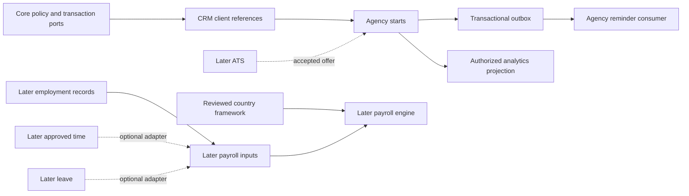

# Module boundaries

Baseline: 1 November 2026. Boundary design MB-001–MB-004 refines the existing module/feature contracts; all implementation remains planned.

## MB-001 — Code and ownership rules

Proposed workspace layout: `apps/web` (Next.js adapters/UI), `apps/worker` (worker entry points), `packages/modules/<module>` (domain, application, policy, persistence adapter), `packages/platform` (sessions, request context, transaction, audit/outbox, entitlement policy), `packages/contracts` (versioned DTO/event schemas), `packages/ui` and `packages/testing`. These are proposed paths, not existing source files.

Only public module application ports and contracts can be imported by another module. Repositories/entities/Prisma models remain internal. Frontend code consumes DTOs, not ORM models. Enforce import restrictions through workspace dependency rules, ESLint architecture checks and a CI import-graph test. Direct SQL access across module ownership is limited to reviewed read-model queries with explicit source permissions; no cross-module writes or hidden cascade behavior.

The modular monolith uses one PostgreSQL cluster and separate logical schemas for bounded contexts where practical. Hard database foreign keys may exist inside the monolith for tenant consistency; record their ownership so extraction replaces them with validated references. Modules cannot modify another module's tables directly, including through database triggers. Avoid an all-purpose shared Person object carrying payroll and candidate access together: shared identity references do not imply shared field access.

## MB-002 — Complete module ownership map

All modules inherit core security and commercial policy. The dependencies in [FEATURE_DEPENDENCY_MATRIX.md](FEATURE_DEPENDENCY_MATRIX.md) remain canonical; optional events below are not new hard activation edges.

| Module | Owns | Public commands/queries or event boundary | R1 |
|---|---|---|---|
| platform.core | Tenant, membership, grants, subscription/order, entitlement revision, quota, audit/outbox | ResolveContext, EvaluateAccess, ReserveCapacity, SetModuleState | Yes; cannot independently disable |
| crm.accounts | ClientAccount, Contact, client relationship | CreateClient, GetPermittedClientReference; ClientArchived | Minimal references only |
| agency.starts | Minimal CandidateReference, Placement, Milestone, Task, Exception, ParticipantGrant, readiness history | CreatePlacement, AssignTask, CompleteTask, DecideReadiness, ConfirmStart; PlacementStarted | Yes; owns fixed reminders |
| hr.records | Person employment projection, Employment, entity/position/organization structures, restricted documents | ApproveEmploymentChange, ExplicitCandidateConversion; EmploymentChanged | No |
| hr.leave | LeavePolicyVersion, ledger, request and approval | ReserveLeave, ApproveLeave, AdjustLeave; LeaveApproved | No |
| hr.lifecycle | LifecycleCase, asset custody references, onboarding/offboarding tasks | StartLifecycleCase, ApproveTransfer; RevocationRequested | No |
| hr.benefits | Enrollment, benefit eligibility, expense claims | RequestEnrollment, ApproveExpense; ExpenseApproved (not Paid) | No |
| talent.ats | Requisition, Candidate profile, Application, Interview, Offer, career posting | AcceptOffer; OfferAccepted with minimal permitted reference | No; later explicit mapping to existing candidate references |
| payroll.inputs | InputBatch, exceptions, approval snapshots, provider-export manifest | ApproveInputs, ExportProviderBatch; InputsApproved | No |
| payroll.engine | PayRun, calculation lines, statements, settlement | CalculateDraft, ApproveRun, PublishStatement; RunFinalized | No; reviewed jurisdiction adapter mandatory |
| workforce.time | TimeEntry, corrections, assignment/timesheet approval | ApproveTimeSnapshot; TimeApproved | No |
| workforce.schedule | Shift, assignment, swap request | PublishRoster, ApproveSwap; RosterPublished | No |
| experience.portal | Self-service presentation preferences, in-app notice, announcement | GetOwnProjection; submit source-domain requests through their ports | No; never owns duplicate HR/payroll masters |
| experience.engagement | Survey, feedback, confidential employee case | SubmitFeedback, AssignConfidentialCase; aggregate-only signals | No |
| talent.performance | Goal, ReviewCycle, submissions, calibration decisions | PublishReview, RecordCalibration | No |
| talent.learning | CourseVersion, program, assignment, completion evidence | AssignLearning, RecordProviderCompletion | No |
| talent.compensation | PlanningCycle, budget, approved compensation proposal | ApproveProposal; CompensationChangeApproved | No; payroll handoff is explicit |
| talent.succession | Skills evidence, restricted succession plan | UpdateSkill, ApproveSuccessionAssessment | No |
| crm.sales | Opportunity, quote, commercial order, forecast snapshot | IssueApprovedQuote; OrderAccepted | No; bookkeeping/payment custody not implicit |
| crm.success | SuccessPlan, health definition/snapshot, renewal | RecomputeHealth, ConfirmRenewal | No; not SaaS-operator tenant administration |
| crm.support | Ticket, queue, SLA clock, knowledge article, CSAT | ReplyToTicket, ResolveTicket, PublishArticle | No; not operator break-glass access |
| platform.automation | Rule version, allowed action registry, run state | DryRunRule, ActivateRule; governed action calls | No; agency fixed reminders require no builder license |
| platform.analytics | Metric/report definitions, saved views, snapshots, export manifests | RunPermittedReport, CreateExport; ExportReady | Agency views only; source data not owned here |
| platform.integrations | Connector settings, encrypted credential references, import job/errors, webhook inbox | PreviewImport, CommitImport; validated calls to owning module | CSV only |
| compliance.country | Applicability framework, rule/retention pack versions, reviewer approval | ResolveApplicableRule, ValidateCoverage | No production rules |
| compliance.uae | Reviewed mainland/DIFC/ADGM adapter implementations and provider format mappings | Pure versioned evaluation through country port | No; research is not activation approval |

Minimal agency CandidateReference stores necessary name/contact/source key only. Later ATS/HR objects link by a reviewed mapping; migrating an existing reference must preserve purpose, subject access and audit rather than automatically broaden access to the person.

## MB-003 — Dependency and event pattern

Arrows denote access/event flow; the authoritative hard prerequisite graph is the existing dependency matrix. Command: synchronous and one transaction when an invariant must be committed together. Event: asynchronous fact after durable commit when failure/retry is acceptable. Use a small tenant-safe reference query rather than copying a complete person record. Domain events never carry bearer credentials, identity documents or salary by default.

Event envelope: event_id, type, schema_version, tenant_id, residency_cell_id, aggregate_id/version, occurred_at UTC, actor/service identity reference, correlation/causation IDs, and minimum validated payload. Record business validity dates separately. Consumers reject unknown tenant/cell/schema combinations, deduplicate durably and reauthorize effects; event publication is not a grant to query the whole tenant.

## MB-004 — Change and extraction constraints

Changing a public contract requires consumer compatibility tests, schema migration, data classification and source-permission review. Tolerate supported old/new event versions during rolling releases; never repurpose an enum or stable module/feature key. An optional target module being off pauses the workflow and records a visible safe exception; it does not silently purchase/enable the target.

Transaction/quota/audit invariants remain together initially. Rendering may be independently scaled now without owning source tables; true service extraction later introduces its own least-privilege data projection and authenticated capability contract. Do not introduce a central event bus, Kubernetes, a global warehouse or a separate permissions microservice without measured need. Multi-country residency can justify duplicating the whole regional monolith before splitting domains into distributed services.
