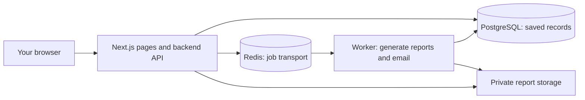

# Open, test and show your ClassPulse project

This is the practical owner handoff. Start here; you do not need to read the planning documents first.

## Where your project is

Your source is in [your GitHub repository, on the working branch](https://github.com/officialibrahimissaka-gif/classpulse/tree/codex/classpulse-mvp-review). Select **codex/classpulse-mvp-review** in GitHub's branch dropdown. `main` is not the latest application. [Download the working branch ZIP](https://github.com/officialibrahimissaka-gif/classpulse/archive/refs/heads/codex/classpulse-mvp-review.zip), or use **Code → Download ZIP** while that branch is selected. Sign in to GitHub if the repository is private.

The ZIP is your actual project source. Extract it; the folder containing `package.json` is the project root. You can edit it, keep your own backups and run it under your own accounts. GitHub stores source; it does not automatically create a working website. **There is no public live app URL yet.** Publishing a Codex environment also does not deploy this app to the public internet.

## First install on Windows

1. Install **Node.js 24** using the Windows installer from [nodejs.org](https://nodejs.org/en/download). Choose version 24, which this project requires.
2. Install [Docker Desktop for Windows](https://docs.docker.com/desktop/setup/install/windows-install/). Docker Desktop runs this project's database, Redis and test email inbox in ready-made containers. You do not need to install those services individually. Follow its Windows/WSL 2 setup prompts and restart if asked. It does not host a public website.
3. Open Docker Desktop and wait for the engine to run.
4. Extract the project ZIP and open the folder containing `package.json` in your editor. In VS Code choose **Terminal → New Terminal**. Run the commands below in that folder, not inside the compressed ZIP.

```powershell
npm.cmd ci
npm.cmd run demo
```

`npm.cmd` avoids the common PowerShell execution-policy problem with `npm.ps1`; do not disable Windows security settings just to run npm. The first command installs the project dependencies. The second prepares local settings, starts Docker services, applies tracked migrations, starts both app and worker, then creates a separate synthetic sample workspace. It never resets your database or changes production services.

Wait for **READY ON THIS COMPUTER**, then open **http://127.0.0.1:3000** on your Windows computer. Keep the terminal open. Press **Ctrl+C** to stop the app/worker; your workspaces stay in the Docker database volume. Start again with `npm.cmd run demo`; existing sample records and your changes are preserved. Local database services remain in Docker Desktop until you stop them; do not delete their volumes if you want to keep your data.

This localhost address works only on the computer running the command. Sending it to someone else does not let them open your app.

## Enter the sample workspace

On the welcome screen:

- Your name: **Portfolio Demo Owner**
- Work email: **demo-owner@example.invalid**
- Click **Continue locally**.
- In **Join your workspace**, enter **portfolio-demo** and click **Open workspace**.

This is an explicitly local test identity, not a real email/password account or public login. The helper creates two fictional clients and five placements, including two confirmed starts, through the real application API. There are no real employee records. On a later run it opens the same workspace without overwriting your changes. Trial/permission rules still apply; the helper does not forge MFA or paid access. To make a separate fresh sample workspace later, use `npm.cmd run demo -- --workspace portfolio-demo-2`. This creates a new synthetic workspace without resetting the old one. To start only the app/services without sample creation, use `npm.cmd run demo -- --no-sample`.

## A ten-minute tour you can do yourself

| Where to go | What to try |
|---|---|
| Overview | See the KPI cards, placement-state bars and source records. Click a KPI to inspect its source cohort. Sample data is dated when first created; expand the date filter if you revisit it in another month. |
| Placements | Open Demo Candidate 3, complete the required checklist with a test evidence note, record readiness, then separately confirm the first day. Notice the difference between ready and started. |
| Clients | Open the two sample clients or create a fictional client with a unique reference. These are client references, not the future full CRM. |
| Overview reports | Select **Freeze report**, choose PDF, click **Generate export**, wait for **Download report** and open the actual file. Then repeat for CSV/XLSX; they use the same frozen values. **Refresh live report** returns to current values. |
| Client participation | Invite a fictional address on an active placement. Open **http://127.0.0.1:18025** for the local Mailpit inbox; open the invite in an incognito/private window and use the invited address. This sends no real external email. |
| Pricing / billing | Open `/pricing` for proposed GHS plans and `/billing` for the owner-only test observation view. No live payment is collected. |

Some administrative controls intentionally require real fresh MFA, which the local test identity cannot provide. Payroll, full HRMS/HCM/ATS and live recurring billing are not implemented. The working portfolio project is **a multi-tenant recruitment/placement operations prototype**, not the entire future global HR platform. The production release is still blocked; ordinary local exploration and synthetic demonstrations are possible now.

## Which files are frontend and backend?

You do not upload individual `.tsx` files as web pages. The project is built and run as an application.

| Folder/file | Plain meaning | Hosting role |
|---|---|---|
| `src/app/` and `src/components/` | Pages, forms, dashboard and interface | Next.js web application |
| `src/app/api/` | Backend endpoints called by the interface | Runs on the server as part of the same Next.js project |
| `src/domain/` and `src/platform/` | Business rules, permissions, sessions and adapters | Backend code, not a separate public website |
| `src/worker.ts` | Processes report/email jobs | Separate continuously running worker; without it report generation stays queued |
| `prisma/r1/schema.prisma` and `prisma/migrations/` | Database structure and tracked changes | Used to prepare PostgreSQL; a database service stores the actual records |
| `assets/` | Fonts used by reports and other application assets | Included with the server build |
| `docs/` and root `.md` files | Instructions, design and research | Keep in GitHub; they are not the running application |
| `.env.local`, `.local/`, `.data/` | Private local settings, keys and generated private data | Keep private. Never upload as a public static folder or commit credentials |
| `node_modules/`, `.next/` | Installed dependencies and generated build output | Generated during install/build; do not use them as your source ZIP |

The frontend and API live in one repository; they are not two separate projects you must guess how to join. PostgreSQL, Redis and the worker are additional running services.



## How to show people

**Today:** you can also open `portfolio-showcase/index.html` immediately, without Docker, and upload that folder alone to Netlify for a clearly labeled static project showcase with actual sample downloads. It does not turn screenshots into an interactive app.

Run the project locally and screen-share the real app. Show the graphs, edit a synthetic placement and generate a PDF while they watch. You can link the GitHub repository and the [downloadable synthetic report examples](portfolio-showcase/README.md) in a portfolio. Those examples are real generated files, not a public interactive deployment.

A truthful description: “I built ClassPulse, a multi-tenant recruitment operations prototype with placement checklists, client participation, dashboards, and PDF/CSV/XLSX reports using Next.js, TypeScript and PostgreSQL. It has a working local demonstration; hosted production and broader HR modules are still being developed/validated.”

**For a shareable website link:** we still need to deploy and connect the full set of services under your hosting accounts. A host account, domain and production identity/storage/email settings are not connected to this chat. No URL should be invented or shown as live until it actually runs.

Your familiar Netlify flow can be part of a future setup for the Next.js web/API portion, subject to compatibility testing. Uploading a static folder does not provide PostgreSQL, Redis, a continuous worker, private report storage or verified sign-in. Those need separate services; an alternative is a full-stack host grouping the web app, worker and data services. Neither option is configured or one-click deployable in this repository today. The AWS production templates already in the project are a later, more involved deployment path—not something you need to install just to explore your portfolio project.

Do not expose this local development login through a public tunnel. A public synthetic demo needs its own reviewed access/data setup, while a real-customer release additionally needs the existing security/privacy/recovery/billing gates. No payment, hosting purchase, public deployment or provider change is performed by the local helper. Hosting is the remaining delivery step, not evidence your source is missing.

## If startup fails

- **“npm is not recognized” / wrong Node version:** install Node.js 24, close/reopen your terminal, then retry.
- **Docker engine unavailable:** open Docker Desktop and wait; follow its WSL 2/restart instructions if it has not finished Windows setup.
- **Port 3000/3001 already in use:** your previous app may still be open. Use its browser window or stop its own terminal; the helper will not kill unrelated processes.
- **Non-local configuration refusal:** use a separate local clone and the generated local settings. The helper refuses production/cloud settings rather than overwriting them.
- **Report remains queued:** keep `npm.cmd run demo` running; it starts the worker as well as the website. Refresh the status after a few seconds.
- **Sample workspace already exists:** that is expected. Use the same local email/workspace address. Your changes are preserved; no reset is necessary.

If you need help, share the error message with credentials removed, not `.env.local` or private configuration. The startup and application tests are executed in the managed Linux environment; the Windows installation itself must be checked on your computer after Docker Desktop is installed.
