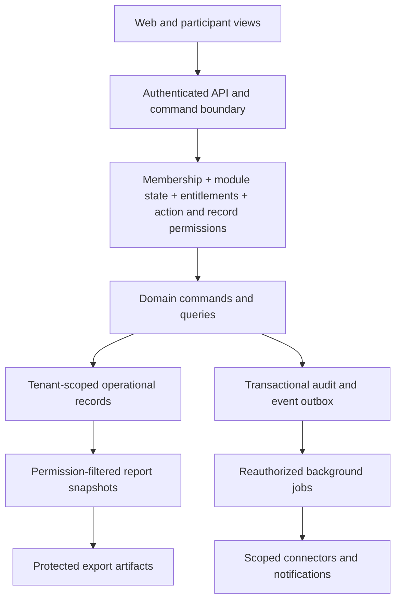

# Product requirements document

Version 0.1 • 1 November 2026 • Proposed product design; no implementation or executed tests.

## Product decision and evidence boundary

ClassPulse is a working product name for a modular B2B employment and business-operations platform. The complete vision spans HRMS, HCM, recruitment, payroll, workforce operations, employee experience, talent and customer operations. R1 is an agency placement-to-start coordination product beside an existing ATS.

The founder requested Phase 1 using the research as the planning input. That request authorizes this specification, not a finding that research hypotheses have become verified facts. [MARKET_RESEARCH.md](MARKET_RESEARCH.md), [PROBLEM_VALIDATION.md](PROBLEM_VALIDATION.md) and [OPPORTUNITY_SCORECARD.md](OPPORTUNITY_SCORECARD.md) remain provisional: source access was blocked, no interviews were supplied, and no current vendor pricing or willingness to pay was established. The agency wedge scored 3.65/5 on researcher assumptions. Payroll-input management was the challenger at 3.20/5. These are inputs to discovery, not validated commercial forecasts.

The product promise for R1 is shared ownership and visibility of accepted-placement tasks. It does not promise employment eligibility, government approval, fewer delays, payment correctness or legal compliance. Full-platform capabilities below are a roadmap with individual release labels, not first-release commitments.

## Requirement provenance

This table maps the specification to its planning inputs; it does not promote an unverified market assumption into a fact. Every normative table/profile below is part of its referenced P, M, F, E, R, K, D or L contract and inherits that contract's story/design/implementation/test trace.

| Requirement family | Planning source | Evidence status |
|---|---|---|
| Agency starts, client references and R1 agency KPIs | Phase 0 hypothesis P1 and integration/repeatability hypotheses P4/P5 in PROBLEM_VALIDATION.md | Unvalidated workflow hypothesis; founder-authorized design baseline |
| Payroll inputs and workforce handoffs | Phase 0 P2 and CUSTOMER_SEGMENTS.md | Challenger workflow; later release |
| Document/readiness and country pack controls | Phase 0 P3 and regulatory verification queue | No current legal rule or country pack verified |
| Full HRMS/HCM, ATS, CRM/sales/CS/support vision and ten dashboards | Founder Phase 1 product-catalog request | Requested product vision, not validated buyer demand |
| Core security, modular commercial access, safe retention and export | Founder Phase 1 subscription requirements and necessary multi-tenant design constraints | Proposed enterprise controls; implementation/validation pending |
| Plans, performance targets, retention defaults and usage caps | Explicit planning assumptions in this specification | Test configurations, not validated prices, legal retention rules or contractual SLAs |

## Users, boundaries and vocabulary

A tenant is one subscribing company/workspace and is the primary security boundary. A tenant may contain employer legal entities and teams. A client organization in agency CRM is a business record, not another tenant's workspace. An individual may have separate memberships in several tenants; switching membership never merges records or grants cross-tenant access. A candidate is not automatically an employee. A confirmed start is not a payroll enrollment or proof of work authorization.

Roles: tenant owner, billing admin, security admin, agency manager, recruiter, HR admin, payroll preparer, payroll approver, line manager, employee, candidate participant, client participant, sales agent/manager, customer-success agent/manager, support agent/manager, integration service account, auditor. Role names are permission bundles, not universal authority; roles can be scoped by entity, team, client, case and self.

Commercial access, authorization and record scope are independent. Paying for payroll does not grant a recruiter access to salaries. A tenant owner does not receive unrestricted payroll, medical or candidate-document access by default. External participants are restricted to explicitly shared fields and tasks in one placement. The SaaS operator's support staff are not tenant customer-support users and require separate audited access.

## Design overview (logical contracts, not a technology selection)

Logical records: Tenant, Membership, RoleGrant, LegalEntity, ClientAccount, Contact, Candidate, Employee, Requisition, Application, Placement, Milestone, Task, Exception, ReadinessDecision, ImportBatch, AuditEvent, ModuleActivation, Subscription, EntitlementGrant, UsageReservation, Job and ExportArtifact. Later modules add payroll, time, talent, revenue and service records without merging candidate and employee identities automatically.

Every business record has tenant_id, immutable ID, version and created/updated timestamps. Scoped records also have legal_entity_id/team/client or case relations where relevant. Business dates are distinct from UTC timestamps; named timezone and currency accompany local schedules and money. Currency is never inferred from UI language. Historical decisions preserve the rule/template version used. Request identity and tenant scope are derived from authenticated membership, not trusted from a request body.

## Outcomes and first-release boundary

R1 covers platform controls, minimal agency client/candidate references, manual and validated CSV placement entry, accepted-offer milestone/task tracking, scoped client participation, reminders, exception ownership, human readiness decisions, agency views, saved views and PDF/CSV/XLSX snapshot exports. Secure document-file storage, native ATS synchronization, candidate self-service, country compliance packs, broad CRM sales, billing automation and report scheduling are later-release items. R1 stores document requirement/status metadata only, not passport/medical/bank-document uploads.

Baseline R1 outcomes: data separation, no unauthorized writes when a module is off, correct start/readiness state, reliable repeated imports and permission-correct exports. Commercial outcome targets require customer baselines and are not invented here. R1 launch and commercial gates are specified in [MVP_SCOPE.md](MVP_SCOPE.md).

## Data classification and retention design

Classification is the maximum sensitivity of the fields returned, not the module label alone:

| Code | Classification | Examples and treatment |
|---|---|---|
| S0 | Public | Published documentation and deliberately public tenant content; no candidate/employee data |
| S1 | Internal business | Workflow templates, non-personal aggregate settings; tenant restricted |
| S2 | Confidential personal/commercial | Names, work contacts, candidate status, client pipeline, placement dates; scoped access, encryption and audited exports |
| S3 | Restricted | Salary, bank/identity documents, health/benefit details, assessments, credentials; explicit field permissions, masking, minimized access and export controls |

Retention profiles are proposed product defaults, not UAE legal retention claims. Each tenant establishes an applicable schedule with counsel before production; an accepted schedule is a launch gate. T-OPS: retain active operational records, then 12 months from explicit archival. T-HR: retain employment records until termination plus 24 months unless the applicable schedule overrides it. T-PAY: no payroll production activation without an approved jurisdiction/entity schedule. T-AUDIT: 12 months from event for minimal metadata, including access/entitlement changes. T-REPORT: export artifacts expire after 7 days; download grants last 15 minutes and recheck authorization. T-SECRET: encrypted connector credentials revoked immediately on disconnect, removed within 24 hours unless evidence preservation is specifically authorized. T-PERSON: candidates/contact-only records archived after 12 months of inactivity, then T-OPS retention; required personal-data erasure can shorten this, subject to lawful holds.

Active employment/contract status is not a universal basis for keeping all data forever. Retention jobs evaluate purpose, entity schedule, subject requests, holds and relationship status by record class. Module deactivation never resets a retention clock. Cancellation grants a proposed 30-day read/export window followed by configured deletion; applicable holds and the agreed schedule take precedence. Recoverable backup copies expire within 35 days after primary deletion and are not restored into active use without reapplying deletion tombstones. These service defaults require technical and legal validation before contract commitments.

## Cross-cutting requirements

### REQ-P001 — Tenant isolation

**Requirement:** Authenticate each request and derive tenant membership server-side; scope database, file, search, cache, analytics and queue access to that tenant, including indirect object references.

**Story:** US-P001 — As a security admin, I need every request isolated to my company so that another company cannot access our records.

**Design DES-P001:** Tenant-scoped repositories and compound foreign keys prevent linking a placement to another tenant's client. Service accounts carry one tenant context. Jobs persist and revalidate that context.

**Implementation IMP-P001:** Planned work item implementing this contract; no code exists. **Test:** [TEST-P001](ACCEPTANCE_CRITERIA.md#test-p001). **Release:** R1.

### REQ-P002 — Identity and membership lifecycle

**Requirement:** Require verified accounts, single-use invitations, MFA for privileged roles and revoke sessions/service credentials on membership removal; privilege changes take effect on the next request.

**Story:** US-P002 — As a security admin, I need expiring invitations and revoked sessions so that access ends when membership ends.

**Design DES-P002:** Invites bind tenant, role, scope and expiry; re-authenticate sensitive changes. Use short-lived sessions and a membership revision check. Self-service recovery cannot grant tenant ownership.

**Implementation IMP-P002:** Planned work item implementing this contract; no code exists. **Test:** [TEST-P002](ACCEPTANCE_CRITERIA.md#test-p002). **Release:** R1.

### REQ-P003 — Least privilege and field authorization

**Requirement:** Evaluate explicit action permission plus tenant/entity/team/self/client scope and field classification on every read and write; deny by default, including derived fields and search facets.

**Story:** US-P003 — As a tenant admin, I need independent action, record and field controls so that a subscription never grants data authority.

**Design DES-P003:** Policy returns allowed fields and predicates before query or serialization. Deny sensitive bulk actions absent separate bulk/export permission. A person holding multiple roles receives the union only within each grant's scope.

**Implementation IMP-P003:** Planned work item implementing this contract; no code exists. **Test:** [TEST-P003](ACCEPTANCE_CRITERIA.md#test-p003). **Release:** R1.

### REQ-P004 — Audit and accountability

**Requirement:** Append tamper-evident audit events for writes, privileged reads, role/entitlement changes, readiness decisions, imports and exports; tenant users cannot edit or erase audit records.

**Story:** US-P004 — As an auditor, I need an immutable account of sensitive actions so that changes and exports are explainable.

**Design DES-P004:** Record actor, tenant, object ID, action, UTC time, request/correlation ID and redacted field changes in the same transaction/outbox. Do not log tokens, document bodies or unrestricted payroll values.

**Implementation IMP-P004:** Planned work item implementing this contract; no code exists. **Test:** [TEST-P004](ACCEPTANCE_CRITERIA.md#test-p004). **Release:** R1.

### REQ-P005 — Privacy, deletion and retention

**Requirement:** Apply the approved per-record schedule, legal holds, subject-access/correction/erasure workflow and backup expiry; module state changes cannot silently delete data or extend retention.

**Story:** US-P005 — As a privacy administrator, I need controlled retention and erasure so that inactive modules do not retain personal data without purpose.

**Design DES-P005:** Retention engine records policy version and due date; deletion creates minimal non-personal tombstones, covers indexes/caches/artifacts and notifies processors. Holds have authority, scope, reviewer and review date.

**Implementation IMP-P005:** Planned work item implementing this contract; no code exists. **Test:** [TEST-P005](ACCEPTANCE_CRITERIA.md#test-p005). **Release:** R1.

### REQ-P006 — Concurrency and reliable commands

**Requirement:** Require idempotency keys for imports, payments-adjacent future commands, metered activation and state transitions; enforce record versions and transactional event delivery.

**Story:** US-P006 — As an operations user, I need safe retries and conflict detection so that repeated requests do not duplicate work.

**Design DES-P006:** Scope idempotency by tenant/actor/operation; mismatched payload reuse conflicts. Compare-and-swap prevents lost updates. Outbox consumers deduplicate by event ID and document ordering expectations.

**Implementation IMP-P006:** Planned work item implementing this contract; no code exists. **Test:** [TEST-P006](ACCEPTANCE_CRITERIA.md#test-p006). **Release:** R1.

### REQ-P007 — Localization and accessibility

**Requirement:** Support named timezones, locale-safe dates, Unicode names and WCAG 2.2 AA interaction patterns in R1 English; design for Arabic/RTL later without claiming translated/legal content exists.

**Story:** US-P007 — As a participant, I need usable dates, language and keyboard access so that I can complete assigned work.

**Design DES-P007:** Persist UTC event instants and explicit local business dates; forms use labelled controls, visible focus, non-color status, screen-reader errors and documented keyboard flows. Record preferred language independently of nationality.

**Implementation IMP-P007:** Planned work item implementing this contract; no code exists. **Test:** [TEST-P007](ACCEPTANCE_CRITERIA.md#test-p007). **Release:** R1.

### REQ-P008 — Operational reliability and performance

**Requirement:** Target monthly 99.5% core API availability, p95 interactive reads under 2 seconds and writes under 3 seconds at the R1 load envelope; define and test recovery RPO 24 hours and RTO 8 hours before production.

**Story:** US-P008 — As an agency manager, I need responsive and recoverable workflows so that operational deadlines remain usable.

**Design DES-P008:** R1 envelope: 20 concurrent users per tenant, 10,000 placements per tenant, 100-row pages and 5,000-row export cap. Measure server processing separately from network. Monitor error budgets, queue lag and restore tests; targets are proposed, not contractual SLAs.

**Implementation IMP-P008:** Planned work item implementing this contract; no code exists. **Test:** [TEST-P008](ACCEPTANCE_CRITERIA.md#test-p008). **Release:** R1.

### REQ-P009 — Secure delivery and secrets

**Requirement:** Encrypt in transit/at rest, scan uploads when later supported, keep connector secrets out of browsers/logs, rate-limit authentication and use approved vulnerability/dependency checks before release.

**Story:** US-P009 — As a security admin, I need protected transport, storage and operational credentials so that sensitive data is not exposed.

**Design DES-P009:** Use managed secret references, short-lived scoped download grants, deny public storage, rotate credentials and restrict operator access. R1 rejects document attachments rather than pretending to scan unsupported uploads.

**Implementation IMP-P009:** Planned work item implementing this contract; no code exists. **Test:** [TEST-P009](ACCEPTANCE_CRITERIA.md#test-p009). **Release:** R1.

### REQ-P010 — SaaS operator access

**Requirement:** Separate operator identities from tenant customer-service roles; require time-bounded tenant approval or documented emergency authority for support access, MFA, purpose and immutable audit.

**Story:** US-P010 — As a tenant security admin, I need controlled vendor support access so that our subscription is not an unrestricted staff backdoor.

**Design DES-P010:** Break-glass access has expiry, narrow field scope, reviewer and tenant notification, with secrets masked. Subscription billing support does not imply employee data access.

**Implementation IMP-P010:** Planned work item implementing this contract; no code exists. **Test:** [TEST-P010](ACCEPTANCE_CRITERIA.md#test-p010). **Release:** R1.

### REQ-P011 — Data provenance and source of truth

**Requirement:** Preserve origin, external ID, last synchronization/import time and actor for imported records; do not overwrite a human decision or merge identities automatically on email alone.

**Story:** US-P011 — As an agency manager, I need to know where imported facts came from so that conflicting records are resolved deliberately.

**Design DES-P011:** Store source revisions and a mapping table scoped by tenant and connector/import profile. Conflicts enter a review queue; a candidate-to-employee conversion requires explicit authorization and mapped fields.

**Implementation IMP-P011:** Planned work item implementing this contract; no code exists. **Test:** [TEST-P011](ACCEPTANCE_CRITERIA.md#test-p011). **Release:** R1.

### REQ-P012 — Controlled configuration change

**Requirement:** Version workflow templates, entity configuration, retention schedules and role bundles; record effective time and actor; preview impact and prohibit retroactive changes to finalized decisions.

**Story:** US-P012 — As a tenant owner, I need versioned company settings so that rule changes do not rewrite past outcomes.

**Design DES-P012:** Draft/published template versions use immutable snapshots attached to placements. New placements use the active version; existing placements migrate only through an audited explicit action.

**Implementation IMP-P012:** Planned work item implementing this contract; no code exists. **Test:** [TEST-P012](ACCEPTANCE_CRITERIA.md#test-p012). **Release:** R1.

## Document map and unresolved decisions

- [FEATURE_CATALOG.md](FEATURE_CATALOG.md): domain/module/submodule features, rules, permissions and sensitivity.
- [MODULE_CATALOG.md](MODULE_CATALOG.md): stable module IDs, packaging and lifecycle contracts.
- [FEATURE_DEPENDENCY_MATRIX.md](FEATURE_DEPENDENCY_MATRIX.md): hard and soft relationships.
- [ENTITLEMENT_MODEL.md](ENTITLEMENT_MODEL.md): authoritative server policy and subscription state.
- [KPI_CATALOG.md](KPI_CATALOG.md) and [REPORTING_REQUIREMENTS.md](REPORTING_REQUIREMENTS.md): metric semantics and ten persona dashboards.
- [USER_STORIES.md](USER_STORIES.md) and [ACCEPTANCE_CRITERIA.md](ACCEPTANCE_CRITERIA.md): traceable planned work and tests.
- [MVP_SCOPE.md](MVP_SCOPE.md): release allowlist and gates.

Open decisions: customer validation and willingness to pay; actual vendor integrations/API eligibility; reviewed UAE scope and provider formats; contracting entity/data-controller responsibilities; approved record schedules and hosting/transfer assessment; infrastructure/stack/team capacity; localized content; actual price points. None prevents completing this proposed design, but applicable decisions gate production activation and commercial claims. No UAE quota, deadline, payroll formula, penalty or data-localization requirement is asserted here.
