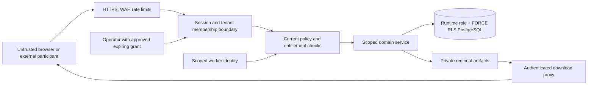

# Security architecture

Baseline: 1 November 2026. SEC-001–SEC-010 refine REQ-P001–REQ-P010, REQ-E001–REQ-E014 and the reporting controls. Design only: no penetration test, compliance certification or production security posture is claimed.

## SEC-001 — Trust boundaries and tenant isolation

The browser, client-supplied tenant ID, uploaded CSV, webhook, queue payload and external system are untrusted. TLS or an authenticated sender does not establish data authorization. Authorize every read/write/count/search/export/queue action. No route, Server Action, report generator or worker can bypass the application policy and transaction context.

Use tenant RLS and composite tenant foreign keys as described in ARCH-004. Runtime DB roles are non-owner, no BYPASSRLS, no schema/role creation and no unrestricted stored procedure execution. A dedicated migration identity is never in web/worker secrets. Test policies with the actual runtime role, including table owner behavior, empty context, prepared statements, raw SQL and view paths. RLS does not replace field/record scope or prevent a fully compromised app from setting another context.

## SEC-002 — Authentication, MFA and sessions

Use regional Cognito OIDC authorization code + PKCE with state/nonce and exact redirect URIs; validate issuer, audience, signature, expiry and approved signing algorithm server-side. Do not store tokens in localStorage or pass IdP refresh tokens to client JavaScript. Exchange verified identity for an opaque high-entropy app session stored hashed in PostgreSQL with subject, region, membership context, session version, idle/absolute expiry and revocation state. Secure HttpOnly SameSite cookies and Origin/CSRF checks protect mutating requests; no mutating GET.

Proposed defaults: 30-minute idle and 12-hour absolute session expiry; step-up verification within 10 minutes for role/entitlement changes, restricted exports, credentials and break-glass. Validate these UX/security settings before implementation. Require MFA for owner/security/billing/payroll-approval/operator roles; prefer supported phishing-resistant methods when verified available, with TOTP as a reviewed baseline. Do not assume every Cognito feature is enabled or available in the selected plan/region. Recovery is audited and cannot bypass tenant ownership or MFA controls.

Check current session/membership/entitlement revision on every request and worker execution; JWT expiry is not the revocation mechanism. Removing membership revokes app sessions/grants immediately and requests IdP token/session revocation as defense in depth. Invitations are hashed, single-use, scoped and expiring; accepting an invitation confirms an authenticated identity and permitted role/scope, not tenant authority from email domain alone. Rate-limit login/recovery/invitations without exposing whether an email exists.

## SEC-003 — Authorization and commercial access

Evaluate role action, grant scope, record relationship, field sensitivity, source module, dependency state, feature entitlement, supported release and quota. Role bundles have versioned named grants; deny by default. Entitlement overrides cannot grant data authority. Entity scope, self scope and placement-specific client grants are explicit predicates, not frontend filters. A tenant owner can manage access without automatically seeing salaries or medical records. Prevent self-escalation and require separate approval for payroll/compensation actions when introduced.

| Principal | Permitted R1 boundary | Explicit denial |
|---|---|---|
| Recruiter | Assigned client/team placements, necessary candidate reference, owned tasks | Other clients/tenants, readiness decision without permission, future payroll fields |
| Agency manager | Granted team/entity placement oversight and readiness decisions | Automatic owner-wide S3 access or unlicensed future modules |
| Client participant | Named placement tasks and approved fields under expiring grant | Account-wide enumeration, other placements, internal notes, readiness overrides |
| Billing admin | Orders, capacities and entitlement configuration within authority | Candidate/employee data merely because billing is allowed |
| Integration principal | Named tenant/source/action scopes, approved connector, current limits | Cross-tenant reads, static all-modules supertoken |
| SaaS operator | Time-bounded approved support scope, MFA, purpose and audit | Standing tenant-data administrator; tenant CRM support role cannot become operator |

Filter unauthorized fields before serialization and aggregation, including totals, error strings, autocomplete, identifiers and facets. Graph relations and download artifact references must be authorized independently. Bulk/exports require distinct permission and limits. Membership changes use current grants rather than cached UI claims.

## SEC-004 — Encryption and secrets

Require TLS 1.2+ with current supported strong configuration on public and service connections; use provider certificates and managed rotation. Encrypt RDS, Redis, S3, backups and logs with regional KMS-backed keys; restrict decrypt rights by workload/purpose. Database disk encryption does not hide salary from an authorized query: later restricted fields need application envelope encryption where the threat/data policy warrants it, with key version and rotation plan. Search/report on encrypted fields requires a reviewed design, not automatic plaintext duplication.

Store credentials in Secrets Manager/KMS, retrieved by workload identity; never in code, Docker layers, Terraform outputs, browser bundles, queue payloads, audit bodies or logs. Separate app, worker, renderer, migration and CI IAM roles. Credential references include owning tenant/connector; disconnect revokes provider access and removes secret material under T-SECRET. Avoid global shared vendor keys if scoped keys are available; disclose provider limitations. Rotate keys with dual-read/re-encryption windows and tested revocation/recovery.

## SEC-005 — File and renderer security

R1 accepts a bounded documented CSV import only and creates report artifacts. Reject document attachment types and forbidden identity/medical/bank fields. Stream/parse with encoding, row/column/field/byte limits; proposed file byte cap is 10 MiB in addition to the 1,000-row cap. Validate MIME/content, mapping, length, formulas and control characters; preserve Unicode safely. Parse in a bounded worker after authenticated staging. No browser-generated success can commit an import.

Future personal-document upload needs explicit purpose, classification, quarantine, malware scanning, content-type verification, decompression limits and restricted download. No public S3 ACL, bucket listing, executable content or direct permanent file link. Object keys contain tenant/residency/artifact UUID, not names or emails. Independent metadata authorizes every object access; prefixes alone are not security boundaries.

Generate structured PDF with PDFKit from controlled templates and local fonts; accept no scripts, arbitrary HTML, remote images or general renderer egress. Use a non-root confined process with CPU/memory/time limits. The R1 renderer needs no Chromium or disabled browser sandbox. Sanitize text and spreadsheet formulas; parse only reviewed local image/font assets. Encrypt artifacts, purge all versions after expiry and use authenticated streaming with current scope checks. Token expiry alone cannot meet next-request revocation for bearer URLs.

## SEC-006 — Audit, telemetry and tamper evidence

Commit append-only audit metadata with the business transaction/outbox. Record tenant, actor, action, object ID/version, purpose where needed, time, correlation, policy/entitlement revision and redacted changes. Do not record raw employee data, session tokens, credentials, message bodies or CSV rows. Privileged reads, exports, downloads, impersonation, policy/retention changes and failed privilege escalation receive audit coverage.

Runtime roles cannot update/delete audit rows. Export minimal audit batches to a regional independently controlled write-once destination, with batch hashes, chained checkpoints and access monitoring. Tamper evidence is not a claim that a database superuser cannot modify anything. Configure retention/Object Lock only after approved schedule/hold policy so immutable payloads do not prevent lawful erasure; avoid personal identifiers in immutable logs wherever possible. Operational logs use opaque correlation IDs, redaction, bounded fields and regional access/retention. An incident must not be investigated by dumping customer records into general logs.

## SEC-007 — Privacy and data lifecycle

Classify S0–S3 as defined in the PRD and track purpose, controller/processor roles, source, permitted recipients, applicable regime, residency and retention rule version. The customer's employer role and the platform's processor role are assessed contractually; agency/client data sharing may create separate controller responsibilities. Employee processing is not universally consent-based: the federal law has employment/contract/legal-obligation exceptions that require purpose-specific assessment.

Implement authenticated subject access/correction/erasure requests with verified scope, lawful-hold review, deadlines from approved regime configuration and an audit of disposition. A hold has authority, reason, affected records, reviewer and review date; it is not an indefinite blanket tenant switch. Module-off preserves records while normal retention continues; it never restarts the clock. Erasure covers primary DB, indexes, artifacts, staged CSV, caches, projections and processors; keep minimal non-personal deletion tombstones to prevent resurrection on restore. Tenant cancellation and backup expiry follow the approved schedule and exit contract, not an unreviewed global legal default.

Current legal evidence and gaps are in UAE_COMPLIANCE_RESEARCH.md. Federal, DIFC and ADGM privacy scope/notification/transfer rules must not be collapsed into one EU/GDPR-style configuration. UAE hosting by itself does not resolve all transfer, support-access, subprocessors or special-category obligations.

## SEC-008 — Backup and recovery

Apply encrypted automated PostgreSQL backups/PITR, protected regional backup storage and periodic complete restore exercises. Redis is reconstructable from durable job state; S3 backup/versioning must respect seven-day artifact and 35-day deleted-backup limits. Record deletion/hold actions in a separately recoverable minimal ledger and apply it before any restored environment serves users or sends notifications.

Target RPO ≤24 hours and RTO ≤8 hours for tested recoverable scenarios from REQ-P008; these remain targets until demonstrated. Multi-AZ covers some AZ/instance failures, not data corruption, ransomware or a full regional outage. Same-country single-region recovery cannot honestly guarantee regional-outage RTO. Cross-region copies require explicit residency/legal approval and an accepted design change; no automatic international backup.

## SEC-009 — Incident response

On-call severity criteria: suspected tenant escape, secret disclosure, unauthorized restricted download or compromised deployment identity is critical. First responder isolates affected route/credential/workload, preserves minimal evidence with chain of custody, identifies impacted tenants/cells/time range, activates incident commander and privacy/legal lead, and records awareness times independently for controller and processor duties. Do not erase evidence or disable audit during containment.

Maintain a notification obligations matrix by controller, regime, incident trigger, awareness time, authority and approved channel. DIFC Article 41 uses “as soon as practicable” for controller notification and “without undue delay” for processor-to-controller notification; ADGM guidance states without undue delay and, where feasible, within 72 hours of awareness. Federal Article 9 delegates timing/procedures to executive rules; no federal 72-hour assumption. Counsel confirms triggers, current rules and content. Internal proposed targets: page critical responders within 15 minutes of detection, begin tenant-impact assessment within 1 hour; these are operational goals, not statutory deadlines.

Contain, investigate, eradicate, rotate/revoke, recover through verified backups/tombstones, communicate through approved contacts, then complete a documented review and remediation ownership. Test both tenant-escape and export-leak scenarios with a tabletop before production. Preserve uncertainty and update affected parties rather than claiming “no breach” from absent logs.

## SEC-010 — Security verification gates

| Test area | Required evidence before relevant production use |
|---|---|
| Tenant and scope isolation | Real PostgreSQL runtime-role tests for API, joins, reports, workers, search, object metadata, missing context and pooled-connection reuse |
| Authentication/session | MFA/step-up, invite replay, CSRF/origin, cookie policy, tenant switch, removal and existing-session/download revocation |
| Commercial/state gates | Direct endpoint, quota races, module-off during writes/dispatch, queued work after downgrade, dependency cascade, retained export |
| Injection and input | Parameterized SQL, stored/reflected XSS, CSV/XLSX formulas, SSRF redirects/DNS rebinding, renderer resource limits, malformed input/fuzzing |
| Supply chain and IAM | Lockfile/SBOM, license check, SAST, dependency/container scan, Terraform policy scan, secret scan, least privilege and deploy-role negative tests |
| Recovery/privacy | Restore from current backups, erasure tombstone replay, expired files/versions, hold review, no post-restore duplicate notifications |
| Independent review | Threat-model review and scoped external penetration test before production; critical authorization findings block launch |

Map tests to existing TEST-P/E/F/R/L IDs and add actual runner/artifact evidence during implementation. Document inspection here is not execution evidence.
