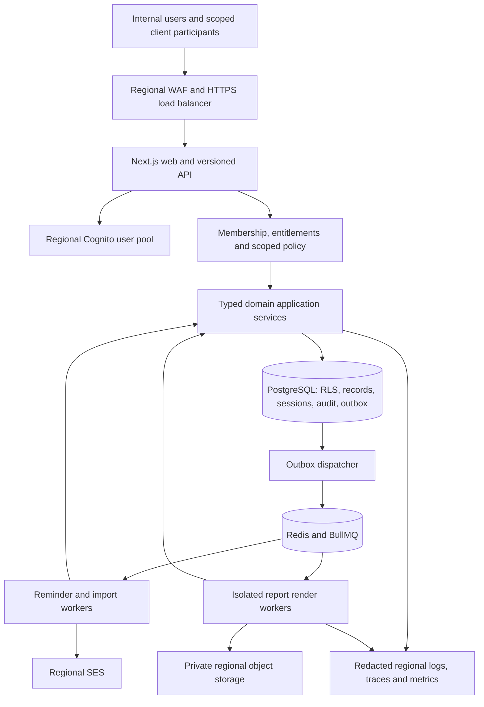

# System architecture

Design baseline: 1 November 2026. Proposed production design; no application, infrastructure, benchmark or security certification was implemented by this phase. Requirements remain the source of product scope. Architectural IDs ARCH-001 onward identify decisions/contracts, not completed work.

## ARCH-001 — Product and deployment shape

Build a **TypeScript modular monolith** for the R1 agency placement-to-start product in [MVP_SCOPE.md](MVP_SCOPE.md). One codebase and release artifact contains domain/application packages, a Next.js web/API entry point, and separate worker entry points. Run web/API and workers as separate containers with the same release version and schema compatibility contract. Separate processes are operational isolation, not independent microservices.

R1 modules: platform.core, crm.accounts, agency.starts, platform.analytics restricted to agency views, and platform.integrations restricted to validated CSV. Fixed reminders belong to agency.starts, not the optional automation builder. Do not deploy payroll rules, document-file ingestion, ATS replacement, public integration APIs or the rest of the roadmap just because their interfaces are documented.

The renderer has no general Internet access and no unrestricted database account. Worker payloads contain opaque IDs, not employee records, email bodies, credentials or document bytes. Regional placement of every component is part of the residency contract, not just a database setting.

## ARCH-002 — Selected coherent stack

| Concern | Selection | Rationale and trade-off |
|---|---|---|
| Web | Next.js App Router, React, TypeScript, accessible component system; next-intl + ICU/Intl | One language and deployment; requires deliberate server/client boundaries and no private full-page caching. English R1, Arabic-ready design, not a claim of translated content |
| Backend/API | Next.js Route Handlers as thin REST adapters to server-only application services; Zod request schemas and generated OpenAPI contract | Avoid a second framework/runtime initially. No business rules in components or routes. NestJS is an extraction option, not an additional R1 API |
| Runtime/build | Node.js 24 LTS baseline, pnpm workspace, locked dependency graph | Current environment provides Node 24. Pin supported patched releases and exact container digests during implementation; no fictitious tested compatibility matrix |
| Database | Managed PostgreSQL 17, initially Amazon RDS PostgreSQL Multi-AZ | Transactions, RLS, relational constraints, JSONB for validated extensions. Confirm regional engine/version availability and extension support before provisioning; never choose an unsupported patch to preserve this major |
| Persistence | Prisma Client with explicit transaction-scoped repositories; reviewed SQL migrations for RLS, constraints, indexes and database roles | Type-safe CRUD without pretending ORM filtering is isolation. Prisma does not define the complete database security model |
| Authentication | Amazon Cognito user pools in me-central-1, OIDC authorization-code + PKCE; application-owned server sessions | Managed password/MFA lifecycle; app still checks membership/revocation every request. Cognito group/JWT claims are not current authorization |
| Authorization | In-process typed policy evaluator + SQL scope predicates + PostgreSQL RLS | Fewer moving parts; needs comprehensive policy tests and strict repository discipline. Defer OPA/OpenFGA until relationships/policy scale justify it |
| Background | BullMQ with regional managed Redis OSS-compatible 7.1 service, durable PostgreSQL Job/Outbox/Inbox records | BullMQ schedules/retries, PostgreSQL preserves business intent. Verify exact BullMQ/managed-engine compatibility; Redis loss must not lose intent |
| Files | Amazon S3 regional private buckets, SSE-KMS, authorized application download proxy | R1 imports and generated exports only, not personal-document upload. Proxy avoids the revocation weakness of standalone bearer presigned links |
| Search | PostgreSQL indexed filters, pg_trgm and controlled full-text search | Tenant/permission scope stays near records. Arabic quality and fuzzy matching need language fixtures; external search deferred |
| Analytics | Permission-filtered PostgreSQL SQL queries and immutable report snapshots; no external warehouse in R1 | Fast path to reconciled operational KPIs. Heavy analytics later gets a separate read model with identical tenancy semantics |
| Reports | CSV via csv-stringify, XLSX via ExcelJS, PDF via PDFKit in a restricted renderer; patched reviewed versions pinned at implementation | Three formats from one snapshot; structured PDF tables/vector charts avoid a browser runtime. PDF layout, embedded fonts and accessible output need explicit tests |
| Notifications | Regional Amazon SES, safe in-app work views; fixed daily reminder worker | Email is a delivery channel, not source of truth or acknowledgment. No SMS/WhatsApp integration promised |
| Testing | Vitest, real PostgreSQL/Redis integration tests via Testcontainers, Playwright UI/download tests plus PDF structure/value fixtures, axe accessibility, k6 load | SQLite/mocks cannot establish RLS or transaction safety. Container tests are for the later coding phase |
| Monitoring | OpenTelemetry, AWS CloudWatch metrics/logs/traces and alarms; CloudTrail for infrastructure | Regional telemetry, lower vendor count; enforce PII redaction and cardinality budgets. External SaaS telemetry is not enabled by default |
| Deployment | Hardened Docker images on Amazon ECS Fargate, ALB, RDS, ElastiCache, S3, KMS, Secrets Manager | Managed operations with bounded container portability; higher baseline cost than a single VM, less administration than Kubernetes |
| CI/CD | GitHub Actions with OIDC to narrowly scoped AWS deploy roles; Terraform; ECR images by digest | No permanent AWS keys. Sensitive migration/run jobs execute inside regional infrastructure; no production data enters hosted CI |

Current documentation reviewed: [PDFKit](https://pdfkit.org/) (Node PDF generation, embedded fonts, tables and vector graphics), [Next.js data security](https://nextjs.org/docs/app/guides/data-security), [PostgreSQL RLS](https://www.postgresql.org/docs/current/ddl-rowsecurity.html), [Prisma transactions](https://www.prisma.io/docs/orm/fundamentals/transactions), [BullMQ idempotent jobs](https://docs.bullmq.io/patterns/idempotent-jobs), [Cognito endpoints](https://docs.aws.amazon.com/general/latest/gr/cognito.html), [SES endpoints](https://docs.aws.amazon.com/general/latest/gr/ses.html), retrieved 1 November 2026. The AWS tables list me-central-1 endpoints for Cognito and SES; this does not establish account quotas, feature availability, sending approval or a complete data-residency guarantee. Other service/version availability remains a pre-deployment check.

## ARCH-003 — Request and transaction boundary

Every interactive operation follows authentication → tenant membership → current membership/entitlement revision → scoped policy → validated command/query → tenant transaction → minimal DTO. Derive tenant from a verified membership in the regional session, never from an arbitrary header or resource ID. Explicit tenant switching revalidates membership and regional placement.

Next.js server-rendered views call the same server-only application/query services used by Route Handlers. Browser code never imports repositories, Prisma, secrets or server-only models. Route Handlers are versioned `/api/v1/...` adapters; Server Actions, if introduced, must call the same boundary and cannot be an alternative authorization path. Private pages use dynamic rendering/no-store, no shared ISR or CDN caching. Request-local memoization cannot survive a request or cross membership contexts.

Application commands own a short PostgreSQL transaction: transaction-local tenant context; membership/module fencing; record-version check; atomic quota reservation; domain writes; audit and outbox insert. Use database unique constraints for idempotency and composite tenant foreign keys for relations. On serialization conflict retry the whole bounded transaction only when the command's idempotency contract is intact. Never let a transaction retry re-send email or another external action.

## ARCH-004 — Persistence and RLS seam

Every tenant-owned table has tenant_id, immutable UUID, optimistic version, UTC audit timestamps, and appropriate legal-entity/team/client references. Unique and foreign keys include tenant_id. Tenant boundary RLS is enforced with ENABLE and FORCE ROW LEVEL SECURITY, a non-owner/non-superuser/non-BYPASSRLS runtime role, and separate migration owner credentials unavailable to web/workers. Default missing tenant context means no rows or denied writes.

Prisma repositories run inside interactive transactions. Set `set_config('app.tenant_id', validatedTenantId, true)` using a parameterized query and transaction-local scope on the same connection before any query. A policy compares tenant_id with NULL-safe current_setting. Never SET tenant context globally on pooled sessions; never call a root Prisma client from inside an authorized repository. PgBouncer, if later introduced, must preserve this transaction behavior; session pooling assumptions are prohibited.

RLS is defense against missing tenant filters, **not protection against an attacker controlling the application SQL role**, which can set context. Application policy also enforces entity/team/self/client/field scope; plain tenant RLS does not do that automatically. SQL injection prevention, narrow database roles, allowlisted queries and policy-aware repositories remain necessary. Security-invoker views preserve RLS; owner-rights views, shared unfiltered materialized aggregates and raw analyst connections are prohibited.

## ARCH-005 — Jobs, side effects and entitlements

PostgreSQL is authoritative for Job, Outbox, Inbox deduplication, usage and status. Dispatcher locks bounded outbox batches, publishes an ID to BullMQ and records delivery progress. A crash between publish and acknowledgment may duplicate delivery: handlers are idempotent by durable event/operation ID, not just temporary Redis job-ID retention. Failed/exhausted work enters a durable reviewed failure state, with redacted error and replay approval.

Reauthorize principal/source/module at execution and before mutation or external dispatch. Job membership is not a frozen grant. Module-off waits for serialized command/dispatch boundaries and stops new writes, notifications, imports, scheduled reports and connector actions. Fixed reminder jobs are registered under agency.starts so optional automation remains off.

For external dispatch, record intent and use a bounded shared dispatch fence against the module's exclusive deactivation fence. In R1, a small worker pool may hold that fence during the bounded provider call; this trades throughput/connection occupancy for predictable deactivation. Deactivation has a timeout and must not claim success while an unfenced new dispatch can start. An already dispatched request can complete after cancellation; record unknown/provider outcome and reconcile rather than claim recall. Exactly-once email delivery is not guaranteed. Lost provider acknowledgment yields uncertain state, not an automatic blind resend. See [integration architecture](INTEGRATION_ARCHITECTURE.md).

## ARCH-006 — Reporting and download revocation

Read/report predicates apply before aggregation. Snapshot metadata includes tenant, requester, metric definition/version, actor scope fingerprint, source versions/watermark, entitlement revision, filters, dates/timezone, currency and maximum sensitivity. Data files are private artifacts, not permission snapshots that remain valid forever. A changed scope makes an artifact stale/inaccessible: regenerate for the reduced scope instead of downloading wider historical rows.

All R1 downloads pass through an authenticated regional application proxy. Recheck current membership, source-module recovery rules, field/record access and artifact scope at request time; then stream from S3. No naked presigned S3 URL is exposed. A 15-minute application download grant is an additional binding, not a replacement for current authorization. Already downloaded copies cannot be revoked; disclose and audit that limit. Artifact retention is seven days with version-aware cleanup.

## ARCH-007 — Traceability and extraction

| Requirement family | Architecture owner | Verification to add during implementation |
|---|---|---|
| REQ-P001–REQ-P004, REQ-P009–REQ-P010 | ARCH-003/004 and SECURITY_ARCHITECTURE.md | Two-tenant direct API, RLS, view/search, operator access, logging tests |
| REQ-P005, REQ-E005–REQ-E007 | SECURITY_ARCHITECTURE.md and GLOBALIZATION_STRATEGY.md | Hold/erasure, module-off, retained export, backup tombstone restore |
| REQ-P006, REQ-E001–REQ-E014 | ARCH-003/005 and INTEGRATION_ARCHITECTURE.md | Idempotency, quota races, revision invalidation, side-effect fencing |
| REQ-P007, REQ-P011–REQ-P012, REQ-F042–REQ-F043 | GLOBALIZATION_STRATEGY.md and UAE_COMPLIANCE_RESEARCH.md | Locale/DST/calendar, effective-date, provenance and reviewed rule fixtures |
| REQ-F001–REQ-F003, REQ-F029, REQ-F038–REQ-F040 | MODULE_BOUNDARIES.md | R1 complete placement/import/client/reminder journey |
| REQ-R001–REQ-R010, REQ-K001–REQ-K022, REQ-D001–REQ-D010 | ARCH-006, SECURITY_ARCHITECTURE.md | Formula fixtures, row/field filtering, all formats, revoked downloads; later dashboards stay disabled |
| REQ-P008, REQ-L001–REQ-L006 | DEPLOYMENT_ARCHITECTURE.md | Load, recovery, security gates, release manifest and actual artifact/test evidence |
| REQ-M001–REQ-M026, other REQ-F records | MODULE_BOUNDARIES.md and ADR registry | Import-boundary enforcement and later-release unavailable-state tests |

These documents refine DES records; existing IMP and TEST records remain not implemented/not executed. Do not replace them with claims that architecture review is passing software evidence.

Extract a service only when measured independent scaling, fault containment, regulatory placement, team ownership or incompatible runtime requirements justify it. First candidates are rendering, notification delivery and vendor connectors; they already have event/DTO boundaries. Payroll may later require separate deployment/control, but no automatic microservice migration is scheduled. Before extraction define authoritative ownership, idempotency, compatibility and failure recovery; replace the in-process port with authenticated calls/events, use the outbox, and remove cross-database transactions rather than pretending they survive the split.
