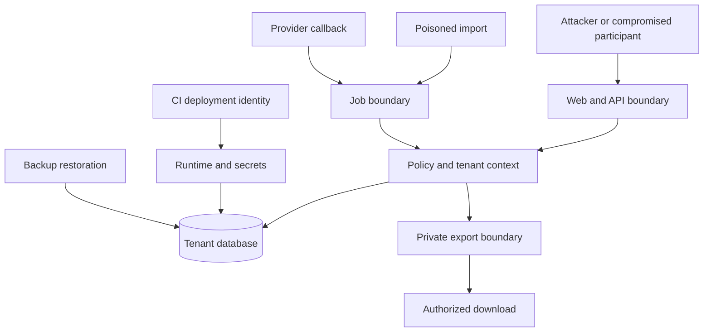

# Threat model

Baseline: 1 November 2026. STRIDE-style design review, not a completed penetration test. Risk ratings are qualitative engineering judgments: critical/high/medium, with residual ratings conditional on tested controls.

## TM-001 — Assets, actors and assumptions

Assets: confidential candidate/client and future employee/payroll data; company segregation; memberships and participant grants; orders/entitlements/usage; readiness/start decisions; report files; connector credentials; audit/provenance; jurisdiction configurations; backups and deployment identities. R1 excludes passport/medical/bank attachments but still handles personal data.

Adversaries: unauthenticated attacker, malicious client participant, compromised recruiter/owner account, malicious or compromised operator, tenant attempting another tenant's records, compromised integration/provider, poisoned CSV/webhook, dependency/build compromise, careless privileged employee. A legitimate tenant administrator can still misuse a lawful export; risk cannot be removed by hiding buttons.

Trust boundaries: browser→web, IdP→app session, authenticated tenant→domain/repository, app→DB RLS, worker→current policy, app→object storage, renderer→untrusted text, provider→webhook, deploy pipeline→cloud, backup→restored runtime and region→region. Queue events and authenticated vendor callbacks remain untrusted inputs.

## TM-002 — Threat register

| ID / STRIDE | Abuse case and affected assets | Initial risk | Mitigation / accountable boundary | Verification and residual risk |
|---|---|---|---|---|
| TM-T01 / disclosure, elevation | Tenant parameter/IDOR exposes another company's placement | Critical | Server-derived membership, composite tenant references, FORCE RLS, policy-aware queries; SEC-001 | TEST-P001/P003, two-tenant direct queries/search/export/jobs; medium pending tests; compromised SQL role remains broad |
| TM-T02 / elevation | Client participant changes ready/start state or enumerates account placements | High | Placement-specific grants, field DTOs, explicit agency decision permission; SEC-003 | TEST-F003, guessed IDs, joins and expired invitations; low only after negative tests |
| TM-T03 / spoofing | Credential theft, invitation replay or recovery bypass | High | OIDC PKCE/state/nonce, MFA, hashed single-use invite, rate limits, audited recovery; SEC-002 | TEST-P002, replay/expired invite and step-up tests; phishing/IdP compromise remains medium |
| TM-T04 / elevation | Stale session/JWT/Redis cache survives member removal | High | App session revocation, authoritative revision check, no JWT-only RBAC; SEC-002/003 | TEST-E014/P002 and concurrent download/job revoke; low conditional |
| TM-T05 / tampering | Module-off or quota bypass through direct API/import/worker | High | Policy at every boundary, transactional capacity, module fences; ARCH-003/005 | TEST-E001/E004/E008/E014, race tests with actual database; medium until concurrency evidence |
| TM-T06 / disclosure | Next.js private cache/RSC serialization leaks tenant data | Critical | Dynamic/no-store private pages, request-local context, minimal DTOs, server-only package imports; ARCH-003 | Same URL under two accounts, cache key/proxy tests, client-bundle inspection; medium because framework upgrades can regress boundaries |
| TM-T07 / disclosure | Forwarded presigned export bypasses revoked access | High | Authenticated proxy, bound grant, source reauthorization and stale-scope rejection; ARCH-006 | TEST-R005 with revoked member/source scope; downloaded copies remain outside recall control |
| TM-T08 / tampering, disclosure | CSV/XLSX formula or markup executes during export/PDF | High | Literal spreadsheet cells, sanitized templates, no renderer network, sandbox/resource caps; SEC-005 | TEST-R006, malicious formulas/HTML/URLs; low after format-specific tests |
| TM-T09 / disclosure | Connector callback SSRF reaches metadata/internal network or leaks token | Critical | Egress allowlist, public-address checks including IPv6/redirect/DNS rebind, no forwarded auth; INT-004 | TEST-F041 with metadata IPs, private targets and redirect chain; medium provider compromise risk |
| TM-T10 / tampering | Duplicate/out-of-order webhook or job repeats side effect | High | Signature/replay check, durable inbox and unique operation ID, ordering/version checks, unknown-outcome reconciliation; INT-002/003 | TEST-P006/F041, lost ACK, late events, Redis rebuild; external exactly-once delivery remains unguaranteed |
| TM-T11 / repudiation | Admin/operator edits audit or accesses data without trace | High | Separate support grant, non-editable runtime audit, external checkpoints, privileged-read log; SEC-006 | TEST-P004/P010, alter/delete denials and checkpoint verification; DB/cloud admin compromise remains medium/high |
| TM-T12 / disclosure | Logs/traces/error payload/CI artifacts contain personal data or secrets | High | Redaction, schema-bounded errors, regional logs, synthetic tests, no production dumps in CI; SEC-004/006 | Secret canaries and log export inspection; medium human-error risk |
| TM-T13 / destruction | Ransomware/operator deletion corrupts records and backups | Critical | Separate roles/accounts, backup access controls, retention and restore drill; DEP-004 | TEST-P008/L003, recover isolated backup plus deletion ledger; regional/account catastrophe remains accepted/gated risk |
| TM-T14 / privacy | Erased data reappears through restore, artifact version or index | High | Tombstone ledger, pre-open reconciliation, all-version file cleanup, subject-request coverage; SEC-007/008 | TEST-P005/E007, timed restore fixture; low only after deletion-store inventory |
| TM-T15 / privacy | Wrong residency route/DR/telemetry moves data internationally | High | Tenant home-cell resolver, explicit transfer approval, regional IdP/storage/logs, export controls; GLOB-004 | Region-route/backup/provider telemetry tests; human downloads and email recipients still require privacy assessment |
| TM-T16 / tampering | Unreviewed/wrong-date UAE rule yields incorrect payroll/settlement | Critical | Unsupported packs off, dual legal/engineering review, applicability resolution and golden fixtures; GLOB-003 | TEST-F042/F043/F015, wrong regime/date/worker type must block; legal change detection remains operational dependency |
| TM-T17 / denial | Large exports, malicious imports or noisy tenant exhausts DB/renderer | High | Per-tenant quotas, bounded rows/bytes, query timeouts, separate renderer pool, fair queue concurrency; DEP-003 | TEST-L005/P008, oversized input/load/queue starvation; medium peak-load risk |
| TM-T18 / supply chain | Malicious package/image/deploy workflow steals all tenant data | Critical | Lockfiles, SBOM, vulnerability/license scans, digest signing/verification, protected branches and OIDC least privilege; DEP-002 | Build provenance, role denial and compromised-dependency simulation; medium/high systemic residual risk |
| TM-T19 / disclosure | Aggregate/differencing reveals salary, survey identity or hidden case | High | Filter before aggregate, independent sensitive measure grant, suppression and anti-differencing design for anonymous surveys; SEC-003 | TEST-R001/F023/K022 with small cohorts and filters; later anonymous analytics unavailable until reviewed |
| TM-T20 / tampering | Candidate/employee identity merge broadens access or overwrites reviewed facts | High | Explicit mapped conversion, source/version provenance, no email-only merge; MB-002 | TEST-P011/F004/F044/F045, duplicate contact and conflicting import cases; manual mapping error remains medium |

## TM-003 — Priorities and risk acceptance

R1 blockers: tenant escape, stale permission writes/downloads, client privilege escalation, dangerous exports, silent import/quota failures, unprotected production identities, unrecoverable data and unapproved retention/residency. Later payroll and personal-document threats are architectural requirements, not permission to ship those modules in R1.

Assign each active threat a named engineering owner, test evidence and review date before release. Product/security owners accept residual business risks explicitly; privacy/legal owners assess statutory implications. A score or architecture diagram does not close a threat. Re-review on new module, country, data class, connector, report type, identity provider, infrastructure region, framework major upgrade or tenant-isolation change.

Use tabletop exercises for tenant escape, leaked export, compromised connector and full-region outage. Record detection, containment, awareness/notification assessment, restoration and actual gaps. Do not claim a risk is eliminated because its control appears in a document.
