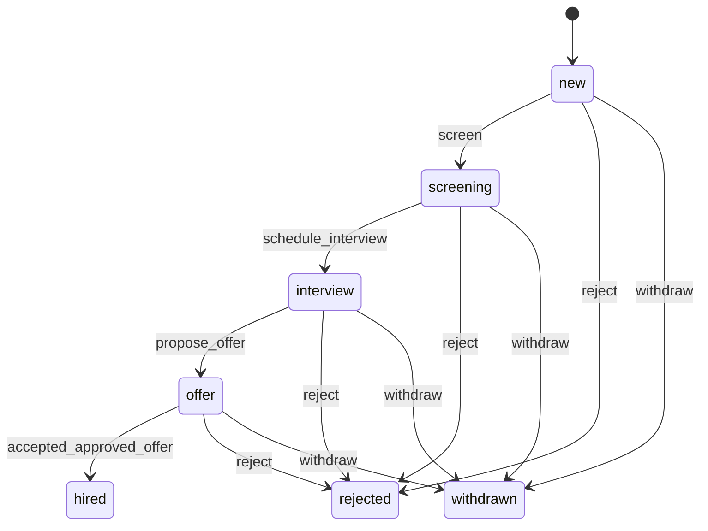
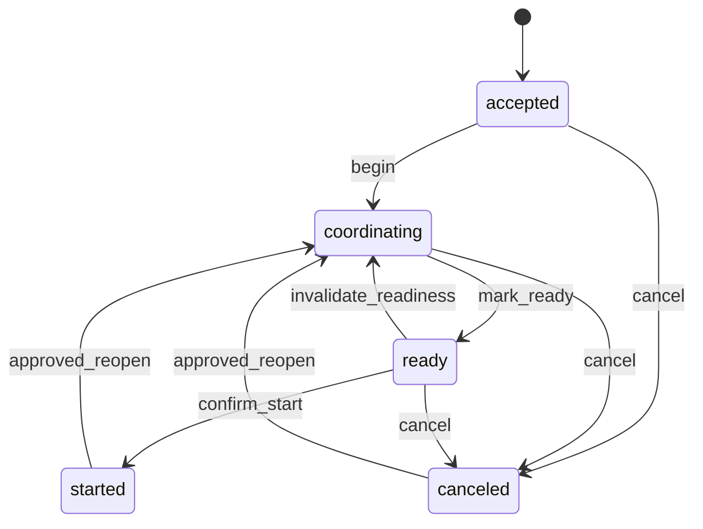
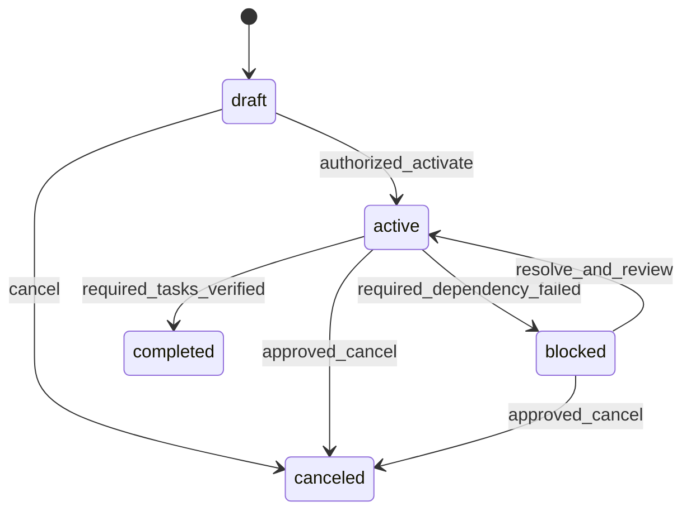
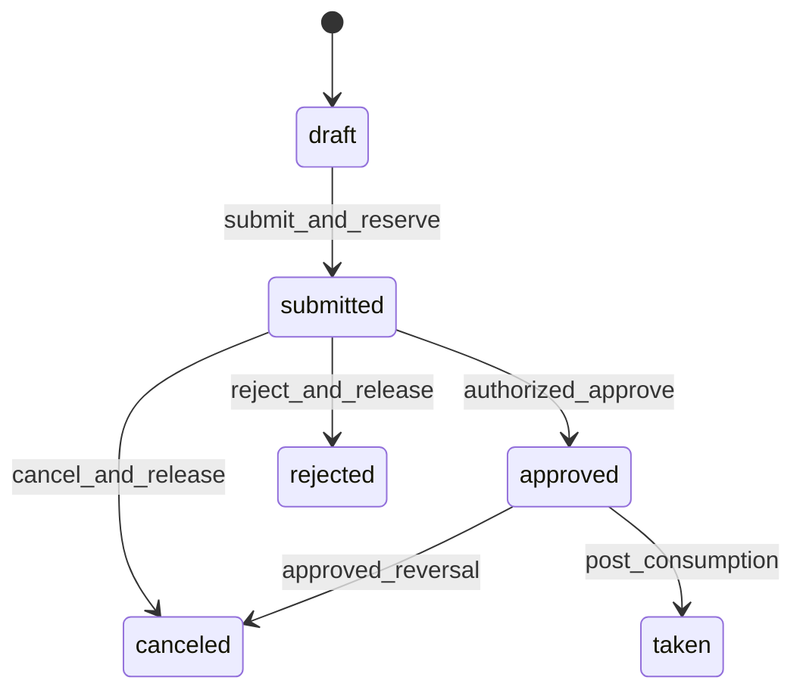
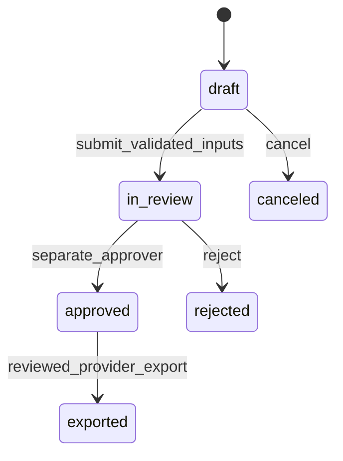
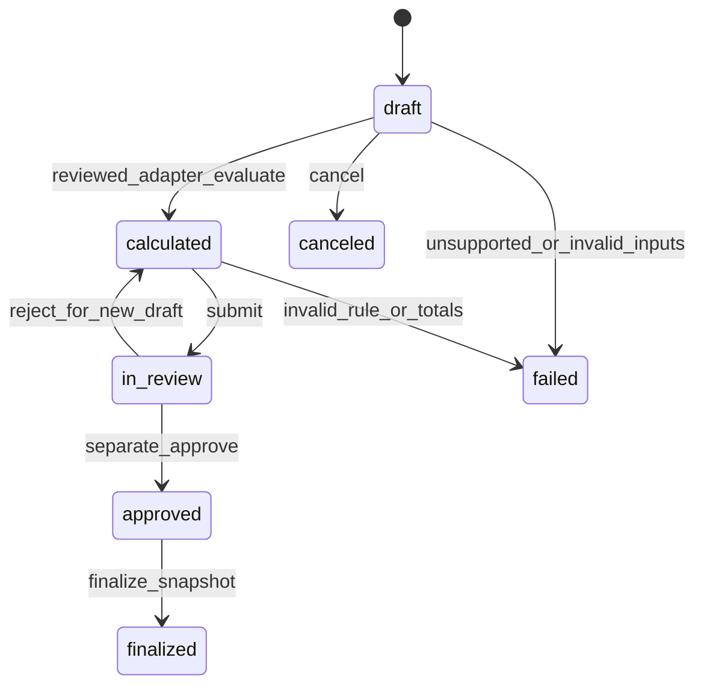
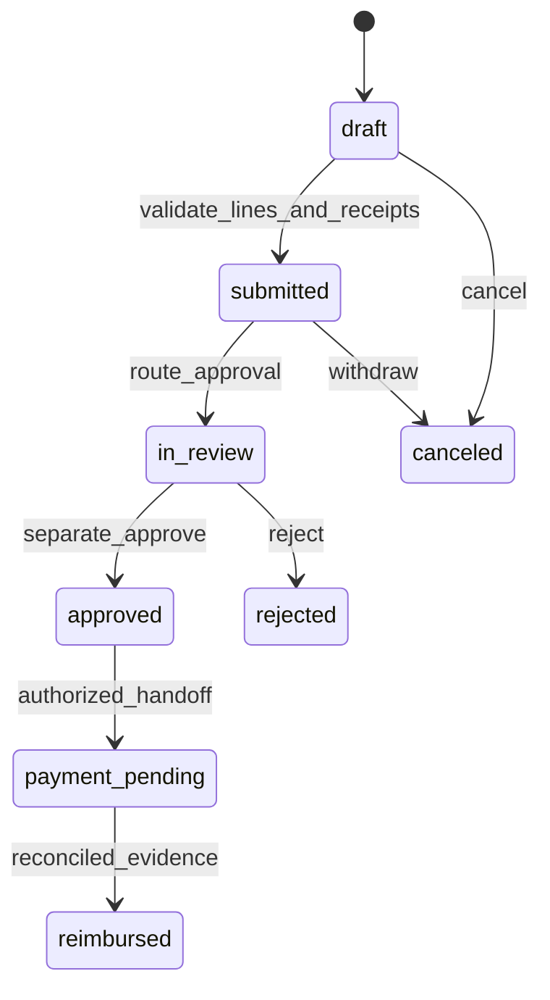
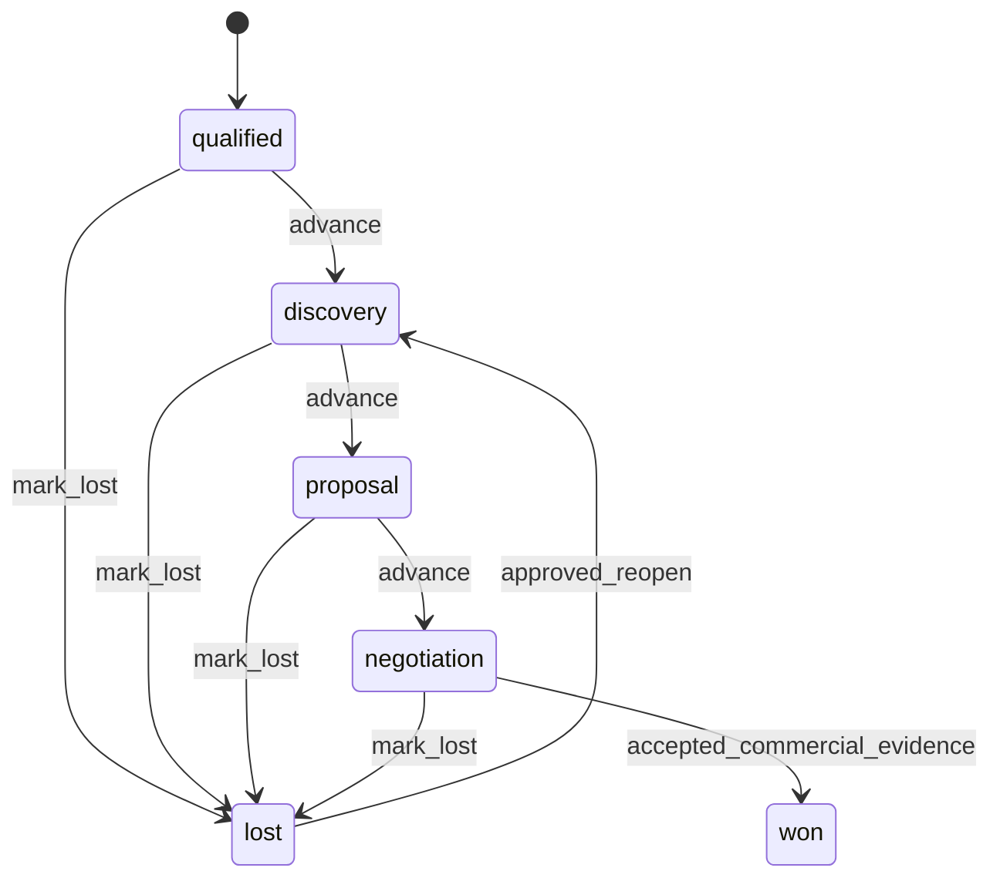
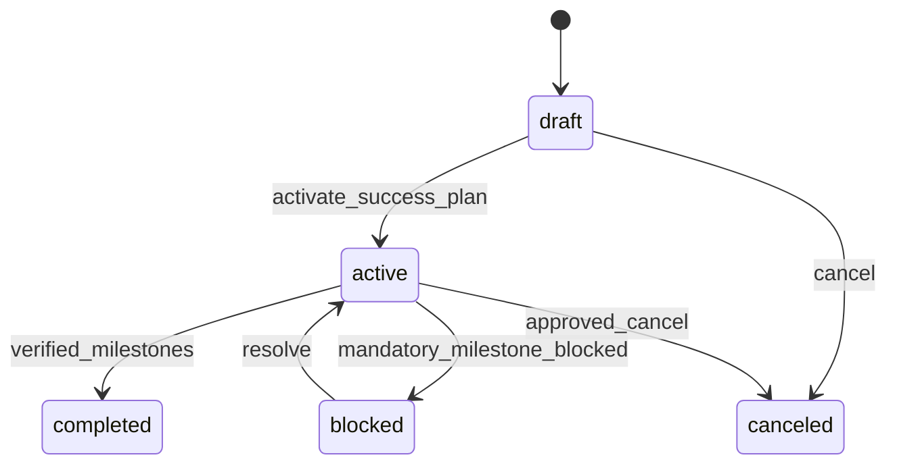
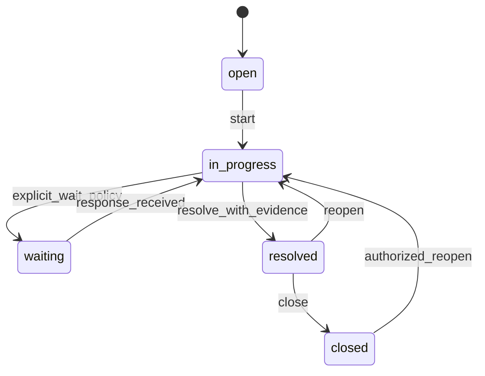

# Workflow state machines and transaction contracts

Baseline: 1 November 2026. WF-001–WF-010 refine the existing REQ-F/E/P contracts. Diagrams describe designed behavior, not running automation. Every transition uses current membership/module/field/record policy, an idempotency key, optimistic If-Match, a locked aggregate row, audit and outbox in the same transaction. Status fields are not writable through generic update APIs. Database state checks validate values; the application command registry validates edges and actor permissions.

## WF-001 — Recruitment, offer and placement

ATS is Later. Only assigned hiring teams can access applications; feedback remains separately restricted. Offer states: draft → in_review → approved → issued → accepted, declined or expired; authorized withdrawal is explicit. Approval cannot be self-authorized where the configured policy requires separation. Issuance requires a reviewed version; acceptance identifies the authorized candidate evidence, not arbitrary recruiter assertion. Repeated acceptance creates one durable handoff event. Corporate hires and agency placements use different mapped targets; if a required optional target is disabled, retain acceptance plus a visible pending handoff, never silently enable it.

R1 starts at an already accepted placement:

Create accepted placement atomically reserves active-placement capacity, validates client/entity/candidate/template provenance, preserves originalPlannedStart, copies milestone/task instances and records creation. Only agency users with placements.decide may waive required tasks, decide readiness, confirm start, cancel or reopen. Required tasks must all exist and be completed/waived with attributable evidence before ready; client completion is a signal for agency review, not employment eligibility.

Replan changes currentPlannedStart with PlacementDateRevision; it never changes originalPlannedStart. Confirm-start requires ready, actualStart, authorized actor and evidence; append PlacementTransition with previous/current states, date and versions. Closing started/canceled releases capacity once. Reopen reserves capacity again, appends transition with previous actual date, clears current readiness/start projection and requires a new readiness review. Do not erase previous starts or reset the original KPI cohort date. Historical starts are in transition evidence; current operational KPIs follow the exact KPI_CATALOG definitions rather than counting all transition events.

Client participants require a verified ContactMembershipLink plus one placement grant; task completion is limited to explicitly assigned/shared fields. Revoke grants/sessions without modifying historical completion attribution. Seed no clients/candidates as employees automatically.

## WF-002 — Employee onboarding and offboarding

Later lifecycle cases distinguish joiner/mover/leaver. Onboarding references approved Employment and template versions, not a copied mutable employee profile. Employment transfers create new effective records and re-evaluate entity scopes. Offboarding keeps planned/approved effective termination, account revocation, asset return and settlement as separate facts. Case completion is blocked by failed mandatory acknowledgments; it does not mark a permit canceled, asset recovered or settlement paid without the appropriate evidence. External connector failure leaves a retryable/unknown exception. Final employment changes and lifecycle completion commit with required approvals/audit; external calls occur through outbox/fenced dispatch.

## WF-003 — Leave request and ledger

Serialize on LeaveAccount before deriving grants, consumption and pending reservations from immutable LeaveLedgerEntry rows. Units, policy/calendar and effective date are explicit; no balance is a mutable number supplied by the client. Submission atomically checks available amount and appends reserve entry. Approval records separate actor; rejection/cancellation appends a release/reversal once, never edits the original ledger entry. Consuming an approved request posts the corresponding amount and releases its reservation atomically under a unique operation key. Enforce request policy/account/employment/entity and source-module permissions. A closed payroll-period correction produces a later delta/batch, not silent recalculation. Legal entitlement calculations require reviewed jurisdiction adapters; no universal annual-leave formula is specified here.

## WF-004 — Payroll input and provider handoff

Input batch membership is the payroll-eligible employment set for one entity/pay period. The prepare/approve transaction locks batch, checks every required input/exception and source version, verifies preparer≠approver and stamps approvedAt. Approved input facts are immutable; provider rejection/correction creates a new batch revision, preserving the approved source. A rejected pre-approval draft can be replaced by a new revision rather than rewriting review history.

Provider export lifecycle: generated → approved → exported → provider_accepted → reconciled, with rejected allowed from exported/provider_accepted if supported by attributable provider evidence. Export carries provider format/rule version, content hash and references. These are separate from wage disbursement. A provider-accepted file is not automatically paid; receipt/disbursement/reconciliation evidence has distinct meaning. No bank connection or supported WPS format is claimed implemented.

## WF-005 — Payroll run and settlement

Approved input batch, applicable compiled RuleVersion, employment terms, currencies, rounding and participation facts are pinned. A run cannot calculate/finalize under unavailable/unreviewed packs. Use exact decimal calculations; persist unrounded and rounded lines, gross/deductions/net and rule reference. Preparer cannot approve. Finalization locks the run and child lines; statements publish only from finalized results.

Finalized is terminal for its contents. Corrections create a new run with adjustsRunId and separately approved delta; do not overwrite published statements or re-run historical rules against changed profiles. Worker/term/currency/context must reconcile before finalization. Settlement has draft/reviewed/approved/due/paid/reconciled facts; an approved amount is not payment. Applicable notice, benefit, scheme and due-date rules remain disabled until legal-reviewed fixtures exist. PaymentEvidence is append-only and targets exactly one settlement or provider export, with provider reference uniqueness scoped appropriately to the configured provider/account in implementation.

## WF-006 — Expenses and reimbursement

Claimant/approver separation is enforced; line currencies must equal claim currency unless a separately reviewed FX-conversion workflow records original and converted amounts/rate/date. R1 has no expense module. Later approved claim lines are locked; changes create a corrected claim/version or explicit adjustment, not an invisible value change after approval. ReimbursementEvidence is immutable; a unique provider operation prevents duplicate recording. PaidAt/state changes are derived from verified evidence. No software approval implies funds moved, and no generic endpoint edits a total.

## WF-007 — CRM sales and order handoff

Advance command's target must be the next permitted stage; arbitrary jumps or a client-supplied probability do not establish a win. Every decision appends SalesStageEvent. Won requires accepted commercial evidence; quote approval/issue snapshots terms and discount authority. Order creation and finance handoff use outbox/idempotency. Lead conversion links explicitly to an authorized existing/new client through the owning service, does not merge contacts by email or grant candidate access. Opportunity amount is not booked revenue or cash; mixed-currency pipeline stays separated. Reopening a won deal requires a separate commercial correction workflow, not a casual state edit.

## WF-008 — Customer onboarding and success

SuccessPlan belongs to the tenant's customer account, not vendor administration of another tenant. Milestones have owners/due/completion evidence. Completion does not imply renewal/payment. HealthSnapshot pins model/factors/source freshness, records missing values as unknown and obeys restricted-source field permissions. Renewal is tied to the due-date contract cohort; confirmed terms/evidence determines renewal, not a health score. Support tickets remain independently scoped.

## WF-009 — Support and SLA clocks

Ticket pins SlaPolicyVersion/calendar; waiting pauses clocks only if that captured policy says so. First qualifying public human reply determines first-response time; automatic acknowledgment does not. Record every pause/resume/resolve/reopen in SlaClockEvent. Resolution is not closure and reopening does not erase the prior response/resolution history. Requester and ticket client must match; restricted cases/replies are not exposed via health summaries or exports. Knowledge public publication is a separate reviewed/sanitized action. CSAT invitation is deduplicated, response recorded once and small/cohort-sensitive reporting follows the KPI/privacy contract.

## WF-010 — Common transaction and recovery table

| Operation | Lock / invariant | Atomic committed work | External/retry behavior |
|---|---|---|---|
| R1 import | Tenant module fence, usage counter, source keys; max 1,000 rows/10 MiB | Whole valid batch's records, quotas, audit, outbox and committed status | No partial silent success; rollback releases reservation; same key/payload returns prior outcome |
| Placement ready/start/reopen | Placement version, mandatory tasks, current grants and active capacity | Decision/transition/history, projection, quota change, audit/outbox | Conflicting update→412; no replayed reminders from reopening |
| Module transition | Entitlement/dependency rows and exclusive dispatch fence | Explicit approved dependent read_only changes and revision bump | Drain bounded in-flight dispatch, cancel pending; timeout is not false success; unknown outcome reconciled |
| Leave submit/approve/cancel | LeaveAccount and request version | Balanced immutable reserve/release/consume entries and approval evidence | No floating-point balance or duplicate reversal |
| Payroll approval/finalize | Batch/run, inputs, reviewed rules, workers | Pinned snapshots, approval separation, immutable results, audit/outbox | New revision/adjustment on correction; never replay a payment from a retry |
| Expense approve/pay | Claim/lines, actor separation, provider operation | Approval or verified reimbursement evidence, state/audit/outbox | Provider timeout→unknown/reconcile, not reimbursed |
| Rule correction/publication | Applicability/version key; current temporal exclusion | Supersede old system-time row and insert reviewed replacement intervals | Prior as-known result remains explainable; no historical re-evaluation |
| Report/export | Repeatable-read authorized source snapshot and export quota | Immutable metric bindings/results plus job manifest | Render outside long DB transaction; reauthorize before publish/download; reject stale scope |

Outbox/Job/Inbox are durable, at-least-once and tenant-scoped. External exactly-once delivery is not guaranteed. State matrices/DTO schemas constrain input; transaction/service tests and policy enforcement must still be implemented. Map end-to-end assertions to existing TEST-P006, TEST-E006/E008/E014, TEST-F001–F003/F013–F018/F031–F036/F038–F043 and release TEST-L004/L005.
