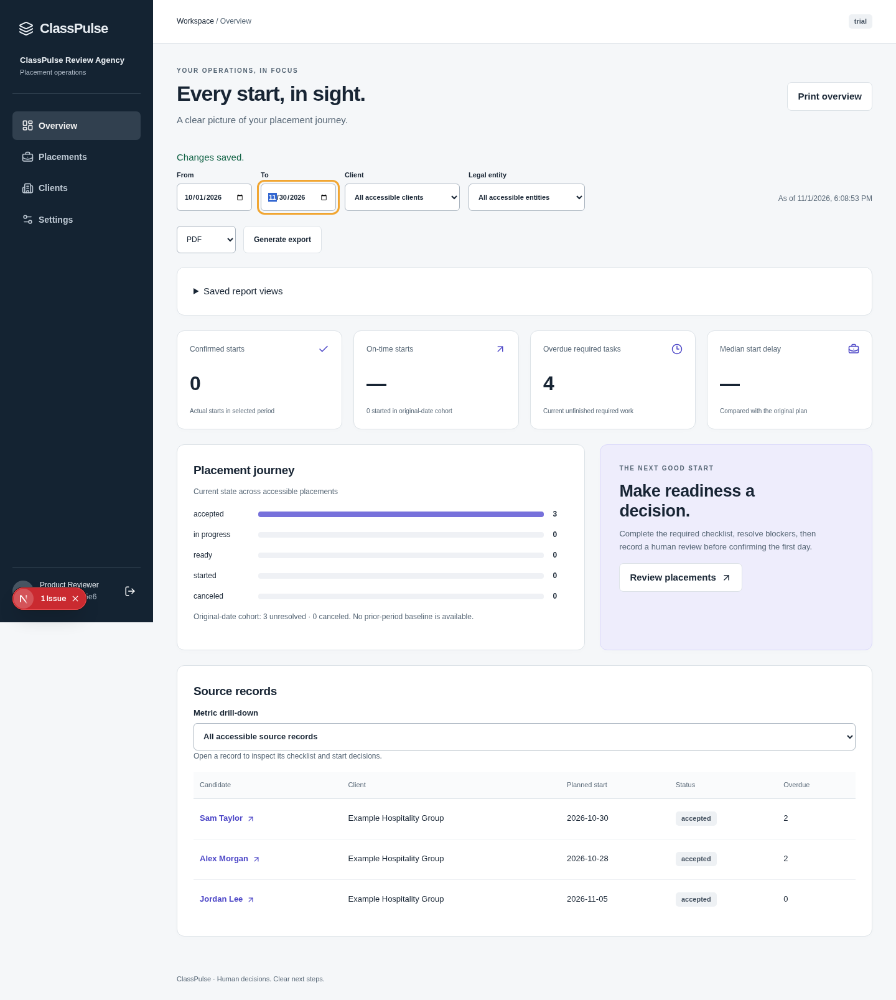
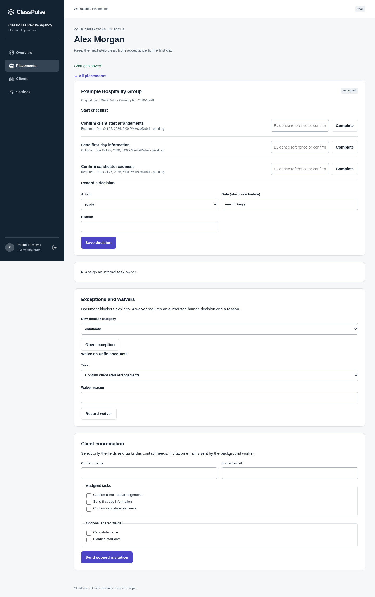
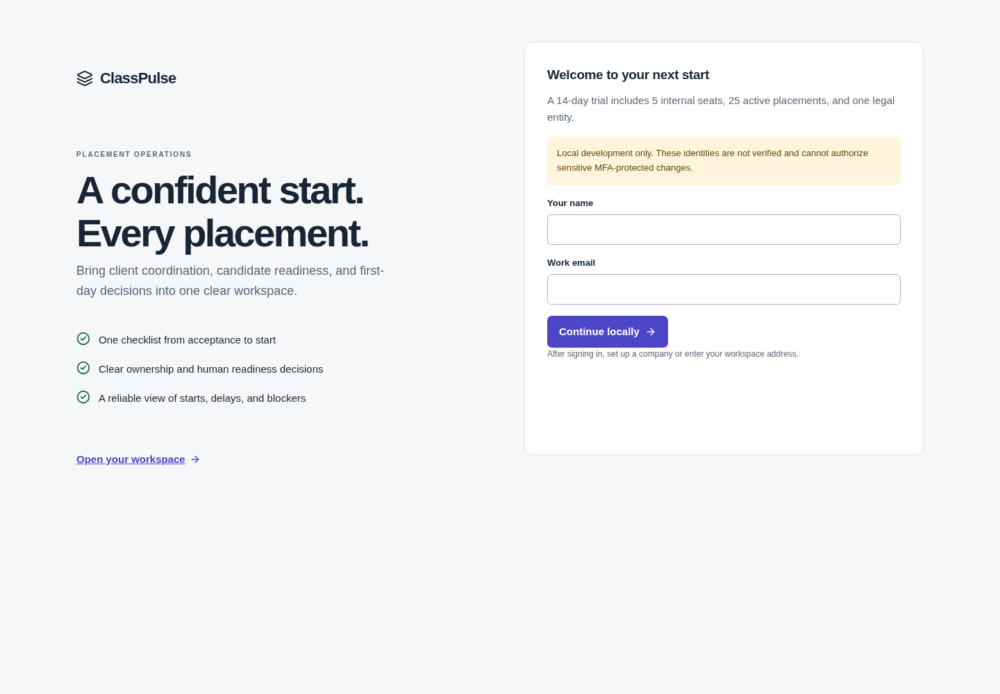
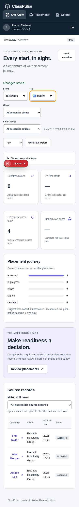

# Actual application screenshots

These captures show the running ClassPulse development application with synthetic review data. They are screenshots, not an interactive deployment. For hands-on testing, follow [START_HERE](../START_HERE.md).

## Dashboard

## Placement checklist

## Welcome and setup

## Mobile layout

The development-server issue badge may appear in these unmodified captures. Production/provider/security/legal/recovery release gates remain documented in [KNOWN_LIMITATIONS](../KNOWN_LIMITATIONS.md).
